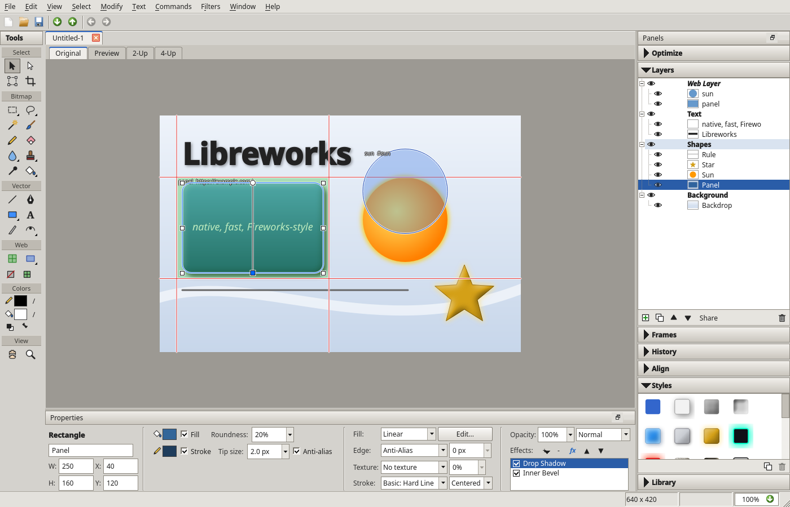
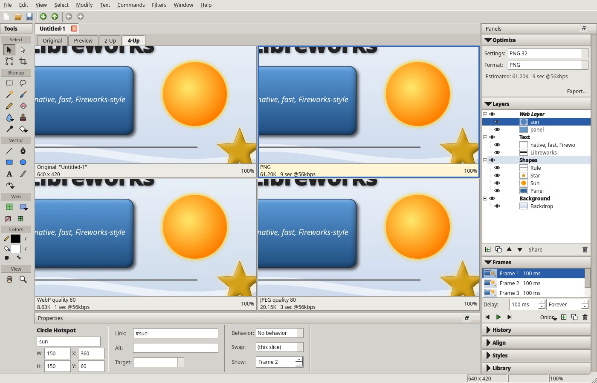
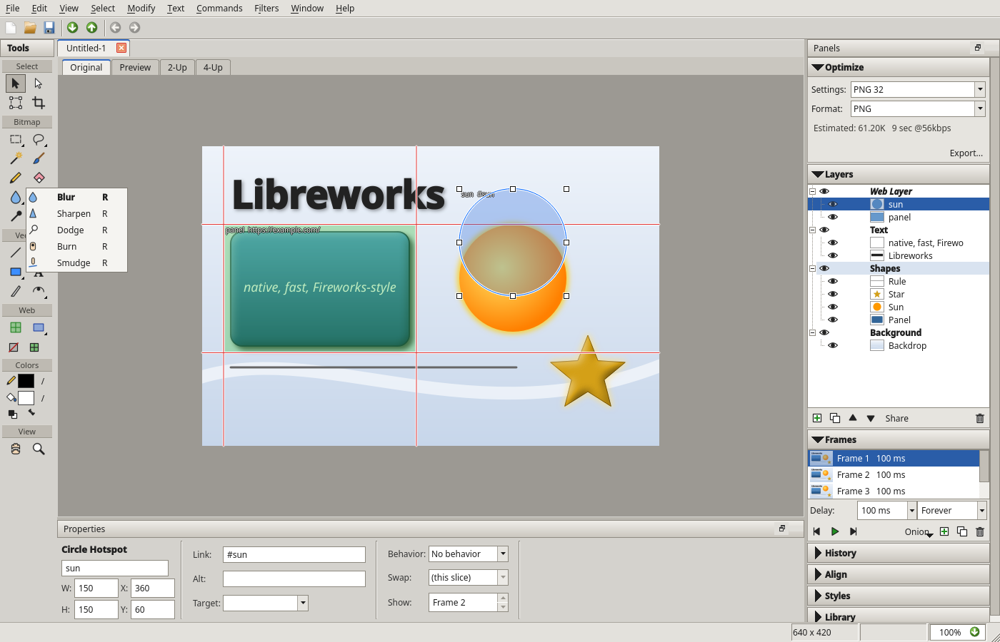
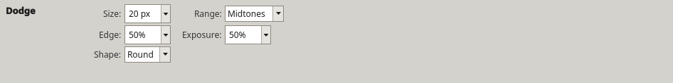
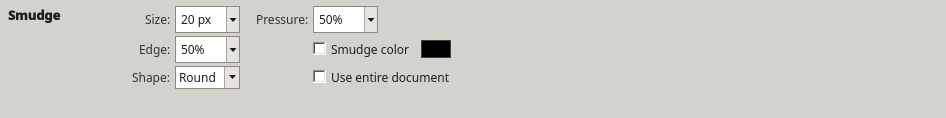
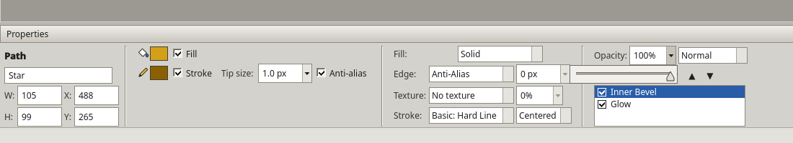

# Libreworks

Libreworks is a native Linux image editor for web graphics. It follows the look
and workflow of Macromedia Fireworks MX 2004 and adds modern formats: WebP, AVIF,
JPEG XL, HEIC, APNG, animated GIF/WebP/AVIF/JXL, layered PSD / OpenRaster / GIMP XCF, SVG, PDF,
camera RAW, HDR (OpenEXR / Radiance), GPU textures (DDS / KTX2), icons (ICO / CUR / ICNS) and more.

It is written in C++17 with Qt 6 Widgets. It is not affiliated with Adobe or Macromedia.



The 4-Up optimisation view (Original, current settings, and two alternatives):



## Features

* **Keyboard prefs tree**: Preferences > Keyboard opens with only **Tools** expanded. Menu Commands (and all nested submenus), Miscellaneous, Modifiers and other categories stay collapsed. The same default applies after switching sets, Restore Defaults or Import, unless you expanded something earlier in that Preferences session. Selection and scroll start at the top of Tools.

* **Shortcut settings migration**: older custom shortcut sets that stored blank tool/liquify/panels keys (from before those actions were in the registry) no longer hide the live defaults. Format 2 stores only overrides; missing = inherit; an explicit empty entry is a deliberate unbind. Preferences and the live bindings share one `sequences()` source.
* **Adding a shortcut updates the tip**: typing a new key for an action that still has only its built-in default replaces that default (so Scale → S shows S, not Q). Otherwise the new key is prepended as primary. **Make primary** is emphasised when several keys are listed.
* **Keyboard prefs scrollbar**: the command-tree vertical scrollbar’s top (thumb at 0 / up arrow) sits below the column header and is clickable/draggable; header clicks on the scrollbar strip are forwarded.

* **Fully customisable tool shortcuts**: assigning a key to Scale (and Skew, Distort, Perspective, Crop, Export Area, and every other tool / flyout member) selects that tool. The old Quick Mask hijack no longer fires from the hardcoded “Q” letter after a rebind. Flyout groups no longer force-sync when you edit one member — shared keys still cycle among whichever tools currently have that key. Tool QActions use WidgetShortcut; MainWindow::event dispatches tool keys so rebinds work with canvas focus.
* **Built-in defaults listed**: Preferences > Keyboard shows the live default keys (V, B, Q, F2, …) on the “Libreworks (default)” / “Bonbon (default)” set; editing any of them auto-forks a custom copy.
* **Auto-fork updates Current set immediately**: adding/removing/reordering a shortcut while a built-in set is selected refreshes the Current set combo the same way Duplicate does — the new “Libreworks (custom)” / “Bonbon (custom)” entry is added and selected at once, with Rename and Delete enabled (no OK/reopen).
* **First shortcut in tooltips**: tooltips, flyouts and labels show only the first listed shortcut and update live after apply / set switch; Preferences > Keyboard lists all of them and can **Make primary** / Move up / Move down.
* **Liquify / panel rename** registered in the shortcut catalog (`liquify.*`, `panels.rename`); Rename’s F2 is no longer hardcoded outside the registry.
* **Keyboard prefs scrollbar**: command tree scrollbar is draggable at the top (splitter/overlap fix).
* **Bonbon window icon**: Alt-Tab / taskbar uses the Bn artwork; `brand.qrc` is forced into the link with `qInitResources_brand()`.

* **Bonbon window icon**: the Alt-Tab / taskbar icon is the Bn brand artwork (all hicolor sizes embedded). `brand.qrc` is forced into the link with `qInitResources_brand()` so the static library can no longer drop it. Bonbon never falls back to the orange Lw mark.

* **Bonbon brand**: `make bonbon` (or `-DLW_BRAND=Bonbon` / `-DBRAND=bonbon`) builds a fully re-branded binary named `bonbon` with its own icon, desktop file, QSettings organisation, About text and packages (`bonbon_<version>_amd64.deb`, `Bonbon-<version>-x86_64.AppImage`, `bonbon-<version>-Linux.tar.gz`). Libreworks and Bonbon install side by side with no file conflicts. Bonbon's native document extension is `.bon` (identical contents and format IDs to `.lwd`; MIME `application/x-bonbon`). It still opens `.lwd`. The on-disk payload stays `application/x-libreworks` inside the ZIP.
* **Bonbon theme**: a built-in light pink theme (seed/accent `#c23b7a`) named **Bonbon**. Selectable in Libreworks; the default on first run and Restore Defaults in the Bonbon build. GNOME-Wine toolbar icons hue-shift to the pink accent.
* **Makefile**: `make` / `make libreworks`, `make bonbon`, `make package`, `make bonbon-package`, `make test`, `make clean`.

* **Bundled GNOME-Wine icons**: the toolbar, menus, zoom field and other standard icons no longer come from the desktop theme (or Qt's grey fallbacks). Libreworks embeds a freedesktop subset of the GNOME-Wine / GNOME-Colors theme (GPLv2+) and maps every `QStyle::standardIcon` / `QIcon::fromTheme` call to those names. The `.deb` and the AppImage therefore look the same.
* **Per-theme hue shift**: coloured pixels of the wine-red palette are shifted to the current interface theme's accent (and brightened slightly on dark themes); neutral greys stay grey. Switching theme updates icons live (icon refresh ~5 ms; full prefs apply still ~300 ms).
* **Preferences > General > Use system icon theme**: off by default. When on, restores the previous system/`standardIcon` behaviour. The setting applies live and is included in settings import/export.
* Custom Fireworks-style Tools panel icons are unchanged.

* **Paste at mouse location**: Preferences checkbox (off by default). When on, Paste (shortcut or Edit menu) centres objects, images and multi-object pastes on the mouse pointer if it is over the canvas; otherwise placement is unchanged. Paste in Place is unaffected.
* **Every shortcut is configurable**: nudge (and Shift-nudge), Delete/Clear, Escape/Enter tool commits, temporary Space-pan, zoom keys, tool keys (including shared cycling keys such as R for Blur/Sharpen/…), colour swap (X) and the rest that used to be hardcoded in the canvas now live in the shortcut registry under Miscellaneous / Tools. Preferences > Keyboard and Help > Keyboard Shortcuts list them; each can have several bindings and can be cleared. Tooltips and flyout menus update live when a tool key is rebound. Pure drag-time modifiers (Shift constrain, Alt from-centre, Ctrl snap / no-snap, and the rest) stay as modifiers — listed under **Modifiers (not editable)** in Help and the Keyboard tab, with a short note.
* **Editing the built-in set auto-forks**: changing any shortcut while the Libreworks (default) set is active creates **Libreworks (custom)** (or **Libreworks (custom 2)**, … if that name exists), switches to it and applies the edit. The key-capture field and + / − stay enabled; only Rename / Delete stay off for the built-in set. A note explains the fork. Custom sets remain renameable.
* Conflict reassignment, live apply, settings import/export and the HTML export cover the newly registered actions.
* **Per-document tool environment**: brush/pencil/eraser size and tip, softness, opacity, blend, two-colour Pencil colours, stroke category/type, fill/stroke colours and gradient choices, magic wand tolerance, text tool font/size, shape settings, Path Scrubber mode, the active tool and the rest of the working tool state are stored in the `.lwd` (format version 5). New documents and opened non-`.lwd` files start from the built-in defaults; switching tabs restores that document's state. Changing tool options does **not** mark the document dirty (as in Fireworks). **Preferences > General > Carry tool settings between documents** (off by default) keeps the last-used tool environment globally in QSettings instead: new canvases inherit it, and opening a `.lwd` that has saved tool state still wins and then updates that carried state. Application Preferences (theme, shortcuts, font folders, slider orientation, Shift fine speed, panel layout, recent files) stay global. Older `.lwd` files load with defaults.
* **Effects ‘+’ button**: the Property Inspector Add Live Effect button no longer shows a menu-indicator arrow; a click still opens the effects menu.
* **Wider font popups**: every font combo (Property Inspector, Text tool options, Find & Replace) opens a popup sized to the widest family name as rendered in its preview face, at least 2.3× the combo width and capped to the screen. The combo's own width is unchanged.
* **Magic Wand samples the active bitmap only**: like Fireworks, the Magic Wand (and Select Similar) flood from the selected / topmost bitmap's own pixels via the shared canvas↔bitmap mapping, so text or other objects sitting above no longer cut their outline into the selection. **Sample all layers** on the Magic Wand Property Inspector page (off by default) restores the old flattened-canvas behaviour.

* **Shift scales fill handles together**: hold Shift while dragging a non-centre handle of a gradient (Linear, Radial, Cone, Contour, Satin, Starburst, Bars, Ripples, Waves, Ellipse, Rectangle) or a pattern fill (the end of its X or Y bar) and the other handle scales with it by the same factor and turns by the same angle about the start / centre, so the fill keeps its proportions and stays symmetric (a uniform scale). The dragged handle still follows the pointer. **Ctrl** now constrains the dragged handle to 45° steps around the start (replacing the older Shift binding); Ctrl+Shift does both. Dragging a pattern bar's middle still turns both axes; its 15° steps moved from Shift to **Ctrl** as well, so Shift only ever scales. The centre handle still moves the fill. Without modifiers nothing changed. Each drag is one undo step.
* **Drag and drop images**: dropping an image file on the canvas adds it as a new bitmap at the drop point (several files are offset slightly and all selected). Dropping outside the canvas (empty workspace, tab bar, docks) opens each file as a new document.
* **Auto-crop on import**: Paste, Import and drag-drop trim a new bitmap to its non-transparent pixels (visible art keeps its canvas position). Opening a file as a new document keeps the full canvas size; the bitmap object inside is trimmed. A fully transparent image stays as it is.
* **Black, White gradient default**: choosing a gradient fill type starts from the Black, White preset (and the gradient editor highlights that preset when the stops match).
* **File > Export Selected...**: opens Export Preview with only the current selection rendered and cropped to its ink bounds (like Export Area). Disabled when nothing is selected.
* **Stroke Category + Type**: the Property Inspector and tool options show a Category list and a Type list (Air Brush Basic / Textured, Calligraphy Bamboo / Quill / …), matching Fireworks. Existing `.lwd` keys still load; a bare category name maps to its first type. Brush tool tips add the same second level (distinct parameters per tip).
* **Preferences > Keyboard**: Fireworks-style shortcut sets (Current set with Duplicate / Rename / Delete; the built-in Libreworks set is read-only), Menu / Tools / Miscellaneous trees, multiple shortcuts per action with + / − and a key-capture field, conflict detection with reassign, saved and applied live.
* **Help > Keyboard Shortcuts**: shows the current (customised) shortcuts, including several per command, grouped by Menu / Tools / Misc, with **Export as HTML...** and **Configure...** (opens Preferences on the Keyboard tab).
* **Export / Import Settings**: next to Restore Defaults; writes or reads a `.lwprefs` INI with all preferences, shortcut sets and font folders, applied live on import.
* **Wider font dropdown**: every font combo's popup list is about 2.3× the combo width (capped to the screen) so long family names show; the combo itself stays the same width.
* **Font sources**: Preferences > General > Fonts has *Use system fonts* (on by default) and *Use custom fonts* with a folder picker (recursive `.ttf` / `.otf` / `.ttc` / `.pfb`). Both may be on; turning both off warns and keeps system fonts. Custom fonts load through `QFontDatabase::addApplicationFont` and refresh live.

* **Shift fine control speed in Preferences**: Edit > Preferences > Editing > *Shift fine control speed* (next to the pop-up slider orientation) sets how fast a pop-up slider moves while Shift is held, from 5% to 100% of the normal speed (default 33%). It applies to Shift-dragging every slider field, and to Shift + mouse wheel and Shift + Up / Down on decimal fields, whose step is scaled by the same percentage (never below the field's smallest unit, e.g. 0.01 on a two-decimal field). Whole-number fields keep Shift + Up / Down = 10 steps. Pressing or releasing Shift mid-drag still never makes the value jump, and the setting is saved and takes effect at once, without a restart (even on a pop-up that is open).
* **Seamless Normal Map / Ambient Occlusion edges**: with *Wrap edges (tileable)* on, the live Normal Map and Ambient Occlusion effects now wrap across the bitmap's own opposite edge, so a tileable heightmap gives a tileable result with no wrong column on the left and right (or row at the top and bottom) edges. Before, the effect ran on the render buffer, which has a transparent margin around the object, so the wrap (and, with wrap off, the edge clamp) read that empty margin as zero height; a canvas view showing only part of the object also wrapped at the view edge. The effects now run on the object's own pixels (the whole object, even when only part is visible), with wrap off clamping at the object's edge, and *Height from: Alpha* no longer fills the margin with an opaque frame. The destructive Filters menu versions were not affected.

* **Shift = fine control on pop-up sliders**: hold Shift while dragging any pop-up slider (vertical or horizontal, in every dialog and panel) for 1/3 of the speed. Pressing or releasing Shift mid-drag never makes the value jump; the drag carries on from the current value. The value accumulates between pixels, so slow moves reach every step (and finer steps on decimal fields). Shift + mouse wheel on a decimal field steps by a tenth of its step; Shift + Up / Down still steps by 10.
* **Clean bitmap edges when scaling**: Bicubic is now a real Catmull-Rom bicubic, Bilinear a triangle filter and Soft a cubic B-spline, all computed in premultiplied colour, centre-aligned and clamped to the edge pixels, so scaling up or down (Scale / numeric transform, Image Size, export scaling, the pixel-art scalers' final resize) never leaves a light or dark fringe and opaque images stay opaque. Axis-aligned scaled bitmaps are drawn on whole pixels, which fixes the 1 px light strip down the left edge after scaling from a left or top handle.
* **Rename in place**: double-click the name of a layer, group, object or mask row in the Layers panel (not the eye, lock or expand arrow), press F2 with the panel focused, or use Rename from the panel's ☰ menu or its right-click menu, and type; Enter or clicking away commits, Esc cancels, and an empty name is ignored. Each rename is one undo step (*Rename Layer* / *Rename Object*), marks the document modified and shows at once in the Property Inspector, Find & Replace and the rest; the expanded groups, the scroll position and the selection stay as they were. The Property Inspector's name field does the same for objects, and double-clicking a frame (or F2) in the Frames panel renames it (*Rename Frame*). The Web Layer keeps its name. Names are saved in `.lwd` and in PSD / ORA / XCF layer names.
* **Contour gradient handles work**: as in Fireworks MX 2004, the round start handle moves the peak (the brightest point of the contour), the end handle's length widens or narrows the spread, and the second handle stretches it along the other axis, so unequal or slanted handles give an elliptical or skewed spread and turning the handles turns it. The default handles give exactly the old distance-from-the-edge look, which older `.lwd` files keep. Handles stay editable with the Pointer, Subselect, Gradient and Paint Bucket tools. Linear and Bars, whose look depends only on the main vector, show no second handle and keep their bands square to the vector when its end is turned. SVG export writes Contour, like the other non-SVG gradient kinds, as a rendered image; PSD uses the rendered layer. `.lwd` files use format version 4; older files still open.
* **Eyedropper on every colour selector**: every colour button (stroke and fill in the Tools panel and the Property Inspector, effect dialogs, gradient stops, Replace Color, the canvas colour in New and Modify > Canvas Color, Preferences, Find & Replace, the Optimize / Export matte and transparency colours (also used for the C header background), procedural textures, grid, guides and favicon colours) opens a Fireworks-style swatch pop-up with web-safe swatches, a hex field, an eyedropper button and **…** for the full colour dialog, which has the same eyedropper. The eyedropper samples anything shown: the canvas as displayed, panels and dialogs, and the rest of the screen. A magnified preview with the colour swatch and hex follows the pointer; click picks, Esc or right-click cancels (arrow keys nudge, Enter picks). It works from modal dialogs, across several monitors and on high-DPI and fractional scales. Effect dialogs, gradient stops and the favicon background preview the colour live while you hover and go back on cancel. On X11 the screen is grabbed; on Wayland the desktop portal's colour picker is used (through D-Bus) when available, otherwise Libreworks' own windows are sampled. `LW_COLOR_PICKER=screen|portal|app` forces a method.
* **Pattern fill handles**: as in Fireworks, a vector with a pattern fill shows handles when selected with the Pointer, Subselect or Paint Bucket tool. Drag the round centre handle to move the tile. The two bars, each with a square end, are the tile's X and Y axes. Drag one bar's end to scale, turn or skew that axis alone, so X and Y scale independently; Ctrl snaps it to 45° and Shift scales both bars together. Drag along a bar to turn both axes about the centre; Ctrl turns in 15° steps. Each drag is one undo step and the canvas updates live. The handles follow the object's own transform. `.lwd` saves them as `patternXform`, but only when they have moved, so untouched patterns and older files keep exactly the old look (the tile at the top-left of the bounds). Styles carry them. SVG export writes pattern fills as a vector `<pattern>`, with the tile as an embedded PNG and the handles as its `patternTransform`. Older builds exported pattern fills as a rendered image.
* **Property Inspector shows every row**: the Properties panel opens tall enough for all of its rows, including W / H / X / Y and the whole Effects list. The height is measured from the panel's own layout for the document, for each kind of selection (bitmap, shapes and their fills, text, group, every auto shape, slice, hotspot, several objects) and for the current tool's options, so it fits in every theme and grows when a theme or style sheet makes the text larger. The canvas gives up the height. The default window (1400 × 900) is made smaller to fit smaller screens, so it still fits a 1366 × 768 screen. Libreworks does not save dock layouts, so there is no old, shorter layout to migrate.
* **Pencil Left/Right colours for pixel art**: turn on *Left/Right colours* on the Pencil's Property Inspector page (off by default) to get a *Left click* and a *Right click* swatch. A left drag paints the left colour and a right drag the right one; the right button shows no context menu while the option is on. Both swatches have the eyedropper and a *Transparent* choice, which erases to alpha 0. The left colour follows the stroke colour until you set it; the right one starts transparent. It works with Pixel perfect, pen pressure (the pen's eraser end still erases), Preserve Transparency, a live Offset effect and the automatic trim of erased margins. Shift-click with either button draws a straight line from the end of the last stroke. Each stroke is one undo step, and the settings are remembered. With the option off the Pencil works as before.
* **Robustness fixes**: Duplicate Layer gives fresh ids to every object, nested group members and symbol instances included (Symbols, imports, tweens and frame copies too), so selecting or editing a copy no longer touches the original. The Web Layer cannot be duplicated, moved, or have a layer moved above it. The undo history has a memory budget (Preferences, above) besides its step count. Damaged or crafted PSD and XCF files can no longer make Libreworks request gigabytes or crash: sizes are computed in 64 bits, every layer is capped at 2^28 pixels, plane data is checked before it is allocated, and XCF RLE tiles stop at their own end; over-size layers are skipped and the file opens as *partial*. Smaller fixes: PNG writing checks libpng's allocations, and the vendored xBR table set-up no longer left-shifts a negative value (undefined behaviour; the table is unchanged).
* **Faster with large documents**, every change checked to give pixel-identical output: committing an edit now records only what changed (commit after a move 3.3 s → 0.8 s, Select All + Clear 3.1 s → 24 ms, stepping through 40 frames 13.2 s → 2.0 s on the benchmark document); rendering keeps a cache per object, so dragging one object of hundreds repaints in about 7 ms instead of 320 ms; marching ants and selection outlines are cached; saving reuses the encoded data of unchanged bitmaps (an unchanged re-save 786 ms → 18 ms); the box blur and Trace Bitmap's colour layers run on all cores (Trace with 64 colours 2.4 s → 0.4 s); the Optimize panel's size estimate and frame thumbnails no longer stall the window (the longest stall went from 1.8 s to 0.3 s).
* **Build options**: `-DLW_STRICT_WARNINGS=ON` turns on extra GCC/Clang warnings (shadowing, useless casts, cast-qual and more) for Libreworks' own code, and `-DLW_SANITIZE=ON` builds with AddressSanitizer and UndefinedBehaviorSanitizer.

* **Layers panel: nested groups keep their eye, lock and expand arrow at every depth.** The eye (visibility) and lock (on a mask row: enabled and chain/linked) now sit in two fixed columns at the left edge that never indent; the indentation and the expand arrow moved into the name column. Previously each nesting level pushed the arrow and eye out of the narrow first column, so nested groups showed no eye and second-level groups had no arrow. The name column fills the panel and grows with the deepest open level (names are elided with "..."); when the panel is too narrow for deep nesting it scrolls sideways instead of squeezing the rows. Clicking an eye or lock changes only that row's object; the arrows, Left / Right and + / - expand and collapse groups and layers.

* **Groups and masks** (Fireworks MX 2004 style). Modify > Group (Ctrl+G) / Ungroup (Ctrl+Shift+G), nested to any depth. The Pointer selects the whole group; double-click a group (or use the Layers panel) to enter it and pick its members, Esc leaves one level; the Subselection tool picks the innermost object directly. Moving, transforming, aligning, Live Effects, opacity and blend mode apply to the group as a unit. Modify > Mask: Paste as Mask, Paste Inside (Ctrl+Shift+V, also in Edit), Group as Mask, Reveal All / Hide All, Disable / Enable, Link (the mask moves with the group) and Delete; vector masks work by outline or grayscale and bitmap masks by alpha or grayscale (Property Inspector: mode, enabled, linked). The Layers panel shows groups as expandable rows (members top first) with a mask row (thumbnail as the mask reveals, eye = enabled, chain = linked). The canvas right-click menu has Group, Ungroup, the Mask submenu and Convert to Bitmap. **Convert to Bitmap** (Modify) rasterises the selection, groups and masks included, keeping the stacking order. Copy / paste / duplicate keep groups and masks (with new ids); pasting while inside a group pastes into it. Trace Bitmap has *Output as a group*. Find & Replace and Batch Replace reach objects inside groups and masks.
* **File formats**: `.lwd` version 3 stores groups and masks (version 1 and 2 files still open; older builds refuse newer format versions with "written by a newer Libreworks"). SVG `<g>` elements open as groups and groups export as `<g>`, masks as `<clipPath>` (vector outline) or luminance `<mask>`. PSD group folders, ORA nested stacks and XCF layer groups open as nested groups with their opacity, blend mode and visibility; a layer holding exactly one plain group (no mask, no effects) exports back as a folder / stack / layer group.
* **Every number field is a pop-up slider field.** No spin arrows anywhere: File > New, Image Size, Canvas Size, the filter and effect dialogs, Preferences, Batch, Trace, Find & Replace, the Property Inspector and the rest use Fireworks-style slider fields (type, Up / Down, Shift+Up / Down by 10, the wheel, or press the triangle and drag). Units, suffixes and the linked width / height are unchanged. Fields with a very wide typed range (e.g. 1 to 16000 px) get a usable slider span of at most ±4096; typing still reaches the real limits. The few number boxes Qt builds itself (the colour picker, Rotate Canvas, Onion Skinning opacity) are given the same triangle and slider automatically.
* **Vertical pop-up sliders are the default** (drag up for more). A saved *Horizontal* choice is kept.
* **Theme switching is fast again**: as quick as earlier releases (it had slowed down for a while). The style proxy is now installed once instead of on every switch, and Find & Replace's long font lists no longer re-measure every font on each restyle.
* **Flatten Selection / Convert to Bitmap** no longer leaves a one-pixel white border around the new bitmap. The bitmap is cropped to its visible pixels, and the stacking order and pixel colours are kept.
* **The canvas right-click Transform submenu** is now the same as Modify > Transform, including Distort, Perspective, the rotate / flip commands and Numeric Transform.
* **Cancelling a new Live Effect adds nothing.** An effect that has a settings window is previewed while the window is open and is only added to the list on OK; Cancel, Esc or closing the window leaves the list (and the undo history) as it was. Effects without settings are still added at once. Cancelling an edit of an existing effect keeps it with its old settings.

**File > New sizes the canvas from the clipboard.** When the clipboard holds an image as the New Document dialog opens, Width and Height are set to its pixel size and a small note under the fields says where it came from, e.g. *Size from clipboard image (1920×1080)*, *Size from copied objects (130×70), 144 ppi* or *Size from image file photo.png (77×55), 72 ppi*. Nothing is pasted: the new canvas is empty (Edit > Paste adds the image), and the clipboard is left alone.
* **What counts as an image**, in this order: Libreworks' own Copy / Cut / Copy Merged (the bounds of the copied objects or pixels, as pasted); an encoded image another program offers (`image/png`, `image/jpeg`, `image/bmp`, `image/gif`, `image/webp`, `image/tiff`, ...); copied image files (`file://` URLs from a file manager; the first readable image); a decoded image in this process. Text, non-image files and an empty clipboard leave the usual 660 × 440 px default (there is no remembered last size).
* **Resolution**: the dialog now has **Units** (Pixels, Inches, Centimeters) and **Resolution** (Pixels/Inch or Pixels/Centimeter, default 72), as in Fireworks. A clipboard image's own resolution is used when its header states one (PNG `pHYs`, JPEG JFIF or EXIF, BMP, TIFF; copied objects carry their document's resolution); otherwise 72. Sizes in inches or centimetres are converted from the pixels; changing the resolution while showing inches / cm keeps the print size. Images over 16000 px are limited to 16000 and the note says so.
* **No freezing**: the clipboard is read only after the dialog is shown, and the size comes from the image header (a 40000 × 30000 PNG is sized without decoding it); only formats that need a full decode to know their size are decoded, on a worker thread, with *Reading clipboard image…* shown meanwhile.
* **X11 and Wayland**: the dialog reads the regular clipboard (not the X11 primary selection) after it is shown and focused, which Wayland requires, and again whenever the clipboard changes while it is open. Anything you type in Width / Height or Resolution wins over the clipboard.
* The document **resolution** is saved in `.lwd` (`resolution`, written only when not 72) and written to PNG (`pHYs`) and JPEG (JFIF density) exports; 72 ppi documents export exactly as before.

**Trace Bitmap.** **Modify > Trace Bitmap...** turns the selected bitmap into filled vector paths (exportable to SVG), with a live preview traced on a worker thread and the path / node count of the current settings.
* **Modes**: *Black and white* (a luminance threshold, optionally inverted, then Potrace-style smooth curves), *Colors* (an adaptive palette of 2–256 colours, the image's own indexed palette, Web 216 or greyscale; *Stacked* shapes that leave no gaps or *Cut-out* shapes that never overlap; smoothing passes that remove specks), *Pixel art (exact)* (one hard-edged polygon path per colour that re-renders the original pixels exactly) and *Centerline* (open stroked paths along the middle of thin dark lines, with the line's average width and colour).
* **Curves**: *Ignore specks up to* (the turd size: specks and holes of at most that many pixels), *Smooth corners* (alphamax: 0 gives polygons, 1.334 no corners) and *Optimize curves* with a tolerance (merges consecutive Bézier segments).
* **Options**: transparent pixels as background (or traced as on white), remove the background colour (the most common border colour), put the paths on a new layer *Trace of &lt;name&gt;* above the bitmap (Libreworks has no group object, so the layer is the group; unticked, the paths go right above the bitmap in its layer) and keep or delete the original. The paths follow the bitmap's placement and transform. The whole trace is one undo step.
* The tracer is Libreworks' own implementation of the method in P. Selinger, *Potrace: a polygon-based tracing algorithm* (2003); no Potrace (GPL) code is used.

**Find & Replace panel.** **Window > Find & Replace** (Ctrl+F) opens a Find panel as in Fireworks.
* **Search**: the document (the current frame), the selection (the objects selected when the search started, so stepping through matches does not narrow it), every frame, or every open document.
* **Find**: *Text* (in text objects; whole word, match case and regular expressions with `\1` back-references in the replacement), *Font* (family and/or size; replacing sets the family and/or size given), *Color* (with a tolerance; in fills, strokes, gradient stops and effect colours such as shadows and glows, and optionally bitmap pixels; colours that do not draw, such as a stroke that is off, are skipped; the alpha is kept and scaled by the new colour's alpha), *URL* (the links of slices, hotspots and objects; an empty Find matches every link) and *Non-Web216* (any colour outside the web-safe 216, changed to the nearest web-safe colour).
* **Find** selects the next match (switching document and frame as needed, wrapping at the end) and lists every match; double-click one to select it. **Replace** changes the selected match and finds the next; **Replace All** changes everything in scope. Each Replace and each Replace All is one undo step per document. Locked layers and locked objects are skipped.
* Batch Process' *Replace colour* and *Replace text* steps run on the same engine, with their output unchanged.

**Replace Color tool and filter.** As in Fireworks, the **Replace Color** tool (in the Rubber Stamp flyout; press **S** to cycle Rubber Stamp, Replace Color, Healing Brush, Spot Healing Brush, Content-Aware Remove) paints a replacement colour over only the pixels that match a source colour.
* **Options** (Property Inspector): **From** — a swatch colour or *Image* (the colour under the pointer where each stroke starts); **Alt+click** samples From from the image. **To**, **Tolerance** (0–100 % RGB distance), **Range** — *Solid* (paint To flat) or *Color* (To's hue and saturation, keeping each pixel's luminance, so shading survives), **Strength** (the tool opacity) and **Pixel perfect** (an aliased tip and all-or-nothing pixels, for pixel art). The usual tip size, softness and shape apply, and a pixel selection limits the stroke.
* Strokes do not build up: every dab is worked out from the pixels as they were when the stroke started, using the strongest coverage so far, so going back over an area never exceeds the Strength. A stroke is one undo step; a stroke that misses every bitmap does nothing.
* **Filters > Adjust Color > Replace Color...** (also a Live Effect) does the same over the whole bitmap or the pixel selection, with From (and a sample picker), Tolerance, Fuzziness (the soft fade at the edge of the tolerance), Range (*Solid*, *Color — keep shading* or *HSL shift* by hue / saturation / lightness), Strength, Hard edges and a black-and-white preview of the matched range. The Batch *Replace colour* step uses the same code with tolerance 0, so its output is unchanged.

**Graphics tablet pressure, tilt and the eraser end.** Pens on Wacom, Huion, XP-Pen and other tablets (Qt tablet events on X11 and Wayland) now drive the painting tools.
* **Per-tool options** (Property Inspector, *Pressure:* row): *Size*, *Opacity* (or *Intensity* / *Exposure* / *Strength* for the tools that have it) and *Flow*, remembered per tool like the other options. Defaults: size on, opacity and flow off. The **Pencil** has *Size* only, so its pixels stay hard and fully opaque. Pressure applies to the Brush (every category), Pencil, Eraser, Replace Color, Blur / Sharpen, Dodge / Burn, Smudge (strength and flow; its tip size is fixed), Rubber Stamp, Healing and Spot Healing Brush, and the Freeform tool's pressure path.
* Pressure is **interpolated** between tablet events, so a fast stroke tapers smoothly instead of in steps; the brush spacing follows the current size. A **mouse** (or a pen without pressure) counts as full pressure, so mouse painting is unchanged.
* **Tilt and rotation**: with *Tilt steers the nib* (Brush options), Calligraphy brushes turn the nib with the barrel rotation (Art Pen) or, without one, the direction of the tilt.
* **Eraser end**: turning the pen over switches to the Eraser; turning it back restores the previous tool.
* **Liquify** brushes follow pressure as the rate, and with *Pen pressure changes size* the size too.
* **Edit > Preferences > Tablet**: a pressure curve you can drag (click to add a point, double-click or right-click to remove one; presets *Linear*, *Soft*, *Firm*), *Minimum size* and *Minimum opacity* (the floor at the lightest touch), *Eraser end switches to the Eraser*, and a test area that paints with the current settings and shows the raw and mapped pressure, tilt and rotation.

**Export Area tool.** As in Fireworks, the **Export Area** tool shares the Crop flyout (press **C** to cycle Crop and Export Area). Drag a marquee on the canvas: it snaps to whole pixels and to the canvas edges (hold **Ctrl** to turn edge snapping off, **Shift** for a square), has eight handles to resize it and can be dragged from inside to move it. The outside is dimmed and a readout shows *x, y  w × h*; the Property Inspector has X / Y / W / H fields and *Export...* / *Cancel* buttons.
* **Enter** or a **double-click inside** opens Export Preview showing only the area (*Export area only* is ticked; untick it for the whole canvas); **Esc** cancels. Every format is cropped to the area: PNG 8 / 24 / 32 and Tiny PNG, JPEG, WebP, GIF, BMP, TGA, QOI and the other bitmap formats, the C header (its width and height are the area's), and SVG / PDF / PSD / ORA / XCF, whose canvas becomes the area. An *Editable PNG* still embeds the whole document.
* The area is remembered for the session per document (choosing the tool again brings it back) and is never stored in the document's export settings, so slices, favicons and the next plain export are unaffected.
* **Export** and **Convert** steps in **Batch Process** have *Export area only* with X / Y / W / H and a *Use saved area* button (the last area used this session); a file whose canvas misses the area fails that step. Scripts store it as `"area": [x, y, w, h]`.
* **File > Export Selection Area...** (enabled when a marquee selection exists) opens Export Preview limited to the selection's bounds.

**Red Eye Removal tool.** In the Rubber Stamp / Replace Color flyout (press **S** to cycle: Rubber Stamp, Replace Color, Red Eye Removal, Healing Brush, Spot Healing, Content-Aware). Click on a red pupil, or drag across one or both eyes: only red-dominant pixels change, judged by their redness *(r − max(g, b)) / r*, so the reddish skin, the iris and the sclera under the brush are left alone.

**Path Scrubber tool.** In the Freeform / Reshape Area flyout (press **O** to cycle: Freeform, Reshape Area, Path Scrubber). Drag along a selected vector path (or click a path to select it first) to change its stroke's per-point size and / or opacity: **Increase (+)** thickens or restores it (up to 2× the stroke width), **Decrease (−)** thins or fades it, with a soft round falloff. Property Inspector: Mode, Affects Size / Opacity, Strength, Size and *Pressure* (tablet pressure scales the size). Hold **Alt** to use the opposite mode while it is held; while the tool is active, **X** swaps the mode instead of the colours. The cursor shows + or −. A path without pressure data is uniform (1.0); points are added where you scrub so the change follows the brush. The data is saved in `.lwd`, every stroke kind (textures included) tapers and fades, and SVG export writes the tapered stroke as filled outlines (readable anywhere) with the original path and its `lw:size` / `lw:opacity` data, which Libreworks reads back.

**Canvas right-click menu.** As in Fireworks MX 2004, right-clicking the canvas opens a context menu; right-clicking an object that is not selected selects it first (a selection you click inside is kept), and clicking empty canvas drops the object selection. The menu is built from the menu bar's own commands, so it shows their shortcuts and enabled states. For objects: Cut / Copy / Paste / **Paste Attributes** (Ctrl+Alt+Shift+V: fill, stroke, Live Effects, opacity and blend of the copied object) / Duplicate / Clone / Delete; Arrange; Align; Transform (the same entries as Modify > Transform: Free Transform, Scale, Skew, Distort, Perspective, Numeric, Remove Transformations, Rotate 180° / 90° CW / CCW, Flip Horizontal / Vertical); Combine Path and Alter Path for vectors and text; a Text submenu (Edit Text, Attach to / Detach from Path, Convert to Paths); Symbol (Convert, Edit and Break Apart for instances, Tween for several); Flatten Selection and Trace Bitmap; a Marquee submenu for bitmaps (Select All, Deselect, Select Inverse, Feather, Quick Mask to edit the selection as a mask); Insert Hotspot / Slice; **Lock Selection** (Ctrl+Alt+L) and **Hide Selection**; Add Live Effect; Save as Style; Edit Gradient (gradient fills); Properties (shows the Property Inspector). A pixel selection on empty canvas gives the marquee commands (modify, Quick Mask, Path from Selection, Bitmap via Copy / Cut). The empty canvas gives Paste, Select All, Image / Canvas Size, Canvas Color, Trim / Fit Canvas, Grid and Guides toggles, Rulers, Zoom (with the magnification presets), **Show All** (Ctrl+Shift+L, also in View) and **Unlock All** (also in Modify). **Group** (Ctrl+G) / **Ungroup** (Ctrl+Shift+G), the **Mask** submenu (Paste as Mask, Paste Inside, Group as Mask, Reveal / Hide All, Disable / Enable, Link, Delete) and **Convert to Bitmap** are offered for objects, as in Fireworks.
* Matched pixels are desaturated to the pupil's own green / blue level and darkened; bright, nearly neutral pixels (the catchlight / specular highlight) are never touched, so the eye keeps its sparkle.
* Property Inspector: tip size, edge (soft edges blend the correction in), shape, **Tolerance** (higher also catches orange-ish or pink pupils), **Darken** and **Strength**; going back over the same place never compounds. A pixel selection limits the brush.
* With a graphics tablet, pen pressure scales the size and/or the strength (the per-tool pressure options); **[** / **]** change the size and **Shift+[** / **]** the edge.

**Pixel-art scalers.** Ten scaling methods built for pixel art — **Nearest Neighbor**, **EPX / Scale2x–Scale4x**, **Eagle**, **2xSaI**, **Super 2xSaI**, **Super Eagle**, **hqx** (hq2x–hq4x), **xBR** (2x–4x), **xBRZ** (2x–6x) and **MMPX** — join Bicubic, Bilinear and Soft wherever an image is resampled:
* **Modify > Canvas > Image Size...**: a *Resample* list (default: the Preferences setting).
* **Object scaling**: with a pixel-art method chosen as the default, bitmaps scaled up on the canvas (Scale / Free Transform handles, Numeric Transform, the Property Inspector W / H) are drawn with it; a non-integer size runs the next whole factor up and then resamples down to the exact size. The pixels themselves are not changed, so scaling back down is lossless.
* **Export Preview**: a *Scale* row (1–1600 %) with its own *Resample* list (*Preferences default* or any method), saved with the document's export settings. **Batch Process > Scale** has the same *Resample* list.
* **Edit > Preferences > General > Interpolation** sets the default for all of the above; choosing a pixel-art method also makes rotation and the transform preview hard-edged.
* **Filters > Pixel Art > Upscale...**: pick a method and a factor (×2–×8) with a before / after preview; a note gives the method's native factors and how other factors are reached (e.g. *×4 runs 2× then 2×*). *Enlarge the object* grows the bitmap's rectangle from its top-left corner; unticked, the object keeps its size and gains the resolution. One undo step.
* Accuracy: ScaleNx, Eagle, 2xSaI, Super 2xSaI, hqx and MMPX match their reference implementations (AdvanceMAME / ScummVM, the MMPX JavaScript, ffmpeg) pixel for pixel on the test sprites in `tests/data/pixelart`; Super Eagle and xBR differ by at most 1 in a channel (rounding). The harness that regenerates the references is in `tools/pixelart-ref`.

**Item views show only the selection highlight.** The Styles panel drew a small dashed rectangle just under the selected style when the list had keyboard focus (the focus frame of the item's empty text area). Every list, tree and table (Styles, Library, Layers, Frames, History, Effects, the Batch dialog, ...) now draws no focus rectangle or dashed current-item outline in any theme; the arrow keys, Home / End and type-ahead still move the current item.

**Fixed: Content-Aware Remove crashed on an ordinary stroke**. Any stroke or selection wider than 14 px makes the fill build an image pyramid; the code kept a reference to the pyramid's first level while appending the coarser levels, the append reallocated the array, and the final write-back read and wrote freed memory (a segfault in release builds, a heap-use-after-free under AddressSanitizer). An earlier test used a 12 px hole, which never builds a second level. Related fixes:
* **Content-Aware Remove** now fills on a worker thread (busy cursor, *Filling…* in the status bar; the stroke stays highlighted until it is done) and applies the result only if the same bitmap still exists unchanged, so undo, deleting the object or closing the document during a fill is safe. A stroke that misses the bitmap or the pixel selection, a locked or hidden bitmap, a vector object or no object does nothing (and adds no undo step); small bitmaps (down to 1 × 1), edges, transparent and scaled bitmaps work.
* **Content-Aware Fill** (Shift+Backspace) runs on a worker thread behind its cancellable progress dialog, cannot be started twice, and applies results by object, ignoring a selection outside the bitmap.
* Very large holes (over 4 megapixels of working area) are filled at a reduced scale instead of taking minutes and gigabytes; the hole edge diffusion is now linear time.
* **Liquify** ignores non-finite or out-of-range brush input and bounds-checks its displacement field; the result is applied only to the bitmap it was opened on.
* New regression tests drive the tool with real mouse events on the canvas (`ui_smoke_test`) and cover the fill and Liquify edge cases (`v030_test`), under ASan/UBSan.

**Filters** (Filters menu; each one with settings opens a dialog with live canvas preview, and is also available as a Live Effect from the Property Inspector's **+** menu, which lists the same categories):
* **Adjust Color**: *Curves* now shows the luminance / channel histogram behind the curve; *Levels* has an **Auto** button (per-channel 0.1 % clip); new **Auto Contrast** and **Gradient Map...** (editable stops, presets such as Sepia and Game Boy, reverse, opacity). Posterize, Threshold and Gradient Map are Live Effects too.
* **Blur > Surface Blur...** (edge-preserving, radius + threshold). **Noise > Reduce Noise (Bilateral)...** (spatial and range sigma, quality). **Sharpen > Smart Sharpen...** (remove Gaussian / Lens / Motion blur, angle, reduce noise).
* **Distort > Lens Correction...** (barrel / pincushion, red-cyan and blue-yellow fringe, vignette amount and midpoint, vertical / horizontal perspective, straighten). **Distort > Liquify...**: its own dialog with Forward Warp (W), Pinch (S), Bloat (B), Twirl Clockwise (C), Twirl Counterclockwise (Alt+C) and Reconstruct (R) brushes, brush size and pressure, Preview and Restore All; one undo step.
* **Other > Content-Aware Fill** (Shift+Backspace): fills the current pixel selection from the surrounding image (multi-scale PatchMatch, deterministic, with a cancellable progress dialog). The brush version is the **Content-Aware Remove** tool in the Rubber Stamp / Healing flyout (S): paint over an object and release.
* **Pixel Art**: **Dither...** (None, Floyd–Steinberg, Atkinson, Jarvis–Judice–Ninke, Stucki, Bayer 2×2 / 4×4 / 8×8; to Web-safe, 1-bit mono, greyscale, RGB565 / 555 / 444 / 332, adaptive N colours or a custom palette; strength, serpentine). **Outline...** (outside / inside, 4- or 8-connected, width, colour, alpha threshold). **Palette Swap...** (colour *i* of *From* becomes colour *i* of *To*, optionally mapping other colours to the nearest; opens with the image's own colours).
* **Texture**: **Normal Map...** (Sobel / Scharr, luminance or alpha height, strength, invert Y for DirectX, wrap), **Ambient Occlusion...** (radius, strength, wrap) and **Make Seamless...** (Mirror edges or Offset and blend, with a blend width). Commands > Make Seamless Tile is still there.

**Pixel art**
* **Pencil** tool option **Pixel perfect** (Property Inspector, Pencil page; with anti-alias off and a 1 px tip): removes the L-shaped corner pixels of a freehand line.
* **Modify > Indexed Color**: **Convert to Indexed...** (Dither dialog preset to an adaptive 256-colour palette), **Edit Palette...** (swatch grid; double-click to edit a colour, add / remove, From Image, Load GIMP `.gpl`, JASC / RIFF `.pal`, Photoshop `.act`, PNG or GIF palettes and Save `.gpl` / `.pal` / `.act`; the bitmap updates live; same-size edits remap index-wise) and **Palette Swap...**.
* **C Header export** has a **Dither** setting (Export Preview > C Header options, `.lwd` saved) used when reducing to RGB565, RGB332, indexed 8-bit or 1-bit mono; three C Header presets were added (RGB565 embedded, 1-bit mono OLED, indexed 8-bit).

**Web**
* Slices and hotspots already existed (Web tools, Property Inspector, File > Export HTML). New: **File > Export Slices...** writes one image per slice (named after the slice, in its own export format) without HTML, and **File > Export Image Map...** writes one image plus an HTML page with a `<map>` of every hotspot (rect / circle / poly, link, alt, target).

**Batch Process** (File > Batch Process...): a wizard like Fireworks'.
1. *Input*: files, a folder (with name patterns and recursion) or the open documents.
2. *Steps*, applied in order, each can be disabled or reordered: **Export** (any export preset or custom optimise settings), **Scale** (percent, fit within, exact size), **Find & Replace** colour (with tolerance) and text, **Rename** (new base name, prefix, suffix, numbering with start and digits), **Command** (flip horizontal / vertical, rotate 90 / 180 / 270, trim, fit canvas, flatten layers, greyscale, invert, auto contrast), **Filters** (any filter with its settings; adjustment filters are baked into bitmaps) and **Convert** (save as `.lwd` or any writable format).
3. *Output*: a chosen folder, overwrite the originals, or overwrite them after backing each original up into a sub-folder (default `Original Files`).

**Save Script... / Load Script...** store the whole batch as JSON. The run shows progress and can be cancelled. Headless:

```
libreworks --batch script.json [--out dir] [--quiet] [files...]
# without files, the script's own input (files or folder) is used; no window is opened
# exit 0 = all OK, 1 = some files failed, 2 = bad script / no input
```

**Vector Auto Shapes** (Vector tools: the Rectangle / Ellipse / Polygon flyout, and the new **Auto Shapes** panel on the right): Rounded Rectangle (per-corner radii), Chamfer Rectangle, Bevel Rectangle, Polygon (sides, roundness), Star (points, inner radius, roundness), Smart Polygon, Arc / Pie / Chord (with inner radius), Doughnut, Spiral, Arrow (head and tail styles), Arrow Line (start / end heads), Connector (elbow), Gear, Frame, L-Shape and Speech Bubble — 16 kinds, plus the original Rectangle, Ellipse and Polygon. Each has:
* **Diamond handles** (yellow) on the canvas for its main parameters (radius, corner size, inner radius, angles, head size, tail point...), with the shape's values shown in the status bar while dragging (Alt+drag a Rounded Rectangle diamond changes that corner alone).
* All parameters in the Property Inspector (*Shape* section).
* **Modify > Alter Path > Convert to Paths** (Ctrl+Shift+P) for free editing.
* `.lwd` round trip of every parameter; PDF export as vectors.
* **SVG round trip**: exported as real `<path>` elements that any SVG program draws; the first `<path>` of each shape also carries `lw:shape`, `lw:rect`, `lw:transform` and one `lw:<parameter>` attribute per parameter (namespace `xmlns:lw="https://libreworks.org/ns/svg/1"`), so File > Open / Import rebuilds the live, editable Auto Shape with its fill, gradient, stroke, opacity and rotation. Programs that keep foreign attributes (Inkscape does) keep the shapes editable. Plain paths are never changed; a shape whose path was edited elsewhere opens as the edited paths (with a note), unknown kinds open as paths, and older files (`data-lw-*` on a `<g>`) are still recognised.


**Fireworks-style workspace**
* Light grey Macromedia-era theme (a custom stylesheet, not Fusion). Combo boxes and spin boxes draw their own small dark arrows (normal, hover, open and greyed when disabled). Tabs (Preferences, Export Preview, panels, documents) draw no dotted focus rectangle around the selected label in any theme; the tab bar still takes keyboard focus and the arrow keys switch tabs.
* **Tools** panel docked on the left. Every tool works; tools that share a slot open a flyout:
  * Select: Pointer, Subselection, Scale, Crop.
  * Bitmap: Marquee, Oval Marquee, Lasso, Polygon Lasso, Magic Wand, Brush, Pencil, Eraser, Blur/Sharpen/Dodge/Burn/Smudge, Rubber Stamp, Healing Brush, Spot Healing Brush, Content-Aware Remove, Eyedropper, Paint Bucket, Gradient.
  * Vector: Line, Pen, Rectangle, Ellipse, Polygon (polygon or star) and the 16 Auto Shapes, Text, Knife, Freeform, Reshape Area.
  * Web: Slice, Hotspot (rectangle, circle, polygon), hide/show slices.
  * Colors: stroke/fill wells, no stroke/no fill, swap (X), default (D).
  * View: Hand, Zoom.
  * Single-key shortcuts as in Fireworks: V, A, Q, C, M, L, W, B, Y, E, I, K, J, N, P, U, T, H, Z, and so on.
  * **[ / ]** make the current tip smaller / larger: Brush, Pencil, Eraser, Blur/Sharpen/Dodge/Burn/Smudge, Rubber Stamp, Healing, Freeform/Reshape Area, and the stroke width of the vector tools. With the Pointer and vector objects selected they change the selected strokes. The step is 1 px below 10 px and about 10% above, clamped to 1–1000 px. **Shift+[ / ]** lower / raise the tip softness (Edge) in 10% steps. The Property Inspector field and the brush cursor ring update as you press; holding the key is one undo step; the keys do nothing while a text or number field has focus.
  * Flyouts: a button with a small dark triangle in its bottom-right corner holds more tools. Click the triangle, press and hold the button (about 150 ms; adjustable in Preferences > Editing), press and drag off it, or right-click it to open the flyout. You can keep the button held, drag onto a tool and release to pick it in one gesture, or click an item once the menu is open. It lists each tool with its icon and shortcut, with the current one in bold. Picking one selects it and the button keeps that tool. Pressing a shared shortcut again (R, G, J…) cycles through the group.

  
* **Property Inspector** docked at the bottom. It is context sensitive:
  * Document: canvas colour, Canvas Size, Image Size, Fit Canvas.
  * Object: name, W/H/X/Y, fill category (solid, web dither, pattern, every gradient kind) with Edit, fill edge (Hard / Anti-Alias / Feather), texture and amount, stroke colour/tip/category/alignment, rectangle roundness, opacity, blend mode, and the Live Effects stack (add from category menus, remove, edit, enable, reorder).
  * Text: font, size (pop-up slider 1–200 with presets; type up to 2000), bold/italic/underline, alignment, kerning, leading, horizontal scale and baseline shift (all slider fields), and the Fireworks anti-alias menu: No / Crisp / Strong / Smooth / System. Anti-aliasing really changes the rendered edges (see `features_test`).
  * Web objects: link, alt, target, behaviour (rollover, swap image), per-slice export format.
  * **Tool options**, laid out like Fireworks MX 2004 (label/field pairs in three-row columns). Every tool has its own page and every control does something; each tool keeps its own size, edge, shape, opacity, blend and texture, saved between sessions:
    * Brush: stroke category, size, edge, tip shape, texture and amount, opacity, blend, preserve transparency, stroke target. Pencil: size, anti-alias, auto erase, preserve transparency, opacity, blend, stroke target. Eraser: tip and opacity.
    * Blur/Sharpen: tip and intensity. Dodge/Burn: tip, range and exposure. Smudge: tip, pressure, smudge colour, use entire document. Rubber Stamp: tip, aligned, use entire document, opacity, blend. Healing / Spot Healing: tip and mode (plus aligned and entire document for Healing).
    * Marquee: style (Normal / Fixed Ratio / Fixed Size, W/H) and edge (Hard / Anti-Alias / Feather + amount). Lasso, Polygon Lasso: edge. Magic Wand: tolerance, edge, contiguous.
    * Paint Bucket: tolerance, fill selection only, fill selected object, fill edge, texture, opacity, blend. Gradient: kind, editable colour ramp, fill selected object, edge, texture. Eyedropper: 1 pixel, 3×3 or 5×5 average.
    * Line, Pen, Rectangle (roundness), Ellipse, Polygon (sides, polygon/star, point angle or automatic): stroke width, kind, stroke/fill on, fill edge.
    * Text: font, size, colour, bold/italic/underline, alignment, anti-alias, kerning, leading, horizontal scale, baseline shift.
    * Freeform / Reshape Area: size, strength, use pressure. Crop: W/H/X/Y of the crop box, Apply / Cancel. Slice, Hotspot: link, alt and target for new objects (Hotspot also switches rectangle / circle / polygon).

    

    
  * **Pop-out slider fields** as in Fireworks: numeric fields (opacity, edge, size, tolerance, quality, effect settings, frame delay, dialog values…) have a small arrow that opens a slider; type a value or drag. A slider drag is one undo step.

    
* Collapsible panels on the right:
  * **Optimize**: presets, format, quality, lossless, colours, palette, dither amount, GIF / PNG 8 **Loss** (lossy palette images: higher values give smaller files with some noise), the **colour table** of GIF and PNG 8 output, PNG type / transparency / 16-bit / interlace / compression / **Tiny compression** / Editable, JPEG encoder / progressive / Huffman optimisation / subsampling / smoothing / sharpen colour edges / metadata, BMP bit depth and RLE, icon sizes and cursor hotspot, DDS / KTX2 block format / mipmaps / zstd, EXR compression / half float, PCX 8-bit, Netpbm Binary/ASCII, TIFF compression / bit depth / alpha / multi-page, TGA RLE / 24 or 32-bit / origin, animated, matte, and a live size estimate (with the Tiny saving).
  * **Layers**: add, duplicate, delete, reorder, show/hide, lock, rename, share across frames, with object thumbnails. The Web Layer holds slices and hotspots.
  * **Frames**: add, duplicate, delete, delay, loop count, play/stop, onion skinning.
  * **History**: click a step to jump to it.
  * **Align**: align and distribute, to the selection or to the canvas.
  * **Styles**: 24 built-in styles; save your own (saved to `~/.config/libreworks/styles.json`), apply, rename, delete.
  * **Library**: graphic, animation and button symbols.
* **Original / Preview / 2-Up / 4-Up** tabs. The tab row keeps a fixed size (no scroll arrows or shrinking text when the window narrows), and document tabs are never elided. Preview runs the real encoder with the Optimize settings and decodes the result, so you see the actual artefacts, file size and download time. Each 4-Up pane keeps its own settings; click one to make it current. Previews zoom with the keyboard (Ctrl+= / Ctrl+- / Ctrl+0 / Ctrl+1) and the mouse (Ctrl+wheel, Zoom tool), and so does the Export Preview dialog. The transparency checkerboard, image and frame share one pixel-snapped rectangle, so no checker sliver shows at the image edge at any zoom.
* **Zoom field** in the status bar: click it for a Fireworks-style popup (6%–6400%, Fit All, Fit Selection, current level checked), or type a level such as 137 and press Enter. It acts on the canvas or on the preview panes.
* **Edit > Preferences** (Ctrl+U): undo steps, **undo memory** (bitmap memory the undo history may hold, 64–65536 MB, default 1024; over it the oldest steps are dropped, the last one always stays undoable), default stroke/fill colours, HDR tone mapping (Clamp / Reinhard / ACES filmic / auto exposure) and exposure, mouse highlight, highlight/selection colours, pick distance, brush-size and precise cursors, interpolation, grid size/colour, transparency checkerboard, flyout hold time, **Pop-up slider orientation** (Preferences > Editing: *Vertical*, the default, like Fireworks' vertical sliders, or *Horizontal*; vertical: drag up to increase, the knob opens level with the field's triangle and the pop-up is kept on screen; applies at once to every slider field, even an open one; saved in the settings), and two separate canvas frame options, **Canvas drop shadow** and **Canvas border**. Both are **off by default** (Fireworks MX 2004 draws the canvas flat on the pasteboard) and apply to the canvas and the preview panes. **File > Open Recent**.
* **Grid, guides and rulers** (View menu): a per-document grid (Edit Grid: size, colour; 1 px grids work), rulers (Ctrl+Alt+R) from which you drag out guides, Show / Lock / Edit Guides, and Snap to Grid / Snap to Guides. Grid and guides are saved in the `.lwd` file.
* **Smart snapping**: moving or resizing objects and dragging the crop box snap to the canvas edges and centre lines and to other objects' edges and centres (within 6 screen pixels), with two-tone guide lines. Hold Ctrl to suspend it. View > Snap to Canvas Edges / Snap to Objects (saved).
* **Overlays stay readable on any background**: selection outlines are two-tone with a halo, the marquee, lasso, zoom and crop boxes use black/white marching ants, handles are white with a dark border, and the brush size ring is drawn black and white.
* **Themes** (Preferences > Themes, [all themes](docs/themes.png)): Macromedia Classic (default), Light, Dark, Midnight, Graphite, Studio 8, Solarized Dark, Solarized Light, Nord, Synthwave, Pink, Pink Night and High Contrast. Changes apply live while the dialog is open, and Cancel reverts them. **Follow system** tracks the desktop's light/dark setting: your theme is kept when it matches, otherwise it switches to its counterpart (Solarized Light ↔ Dark, Pink ↔ Pink Night) or to Dark or Classic. You can override the accent colour and the pasteboard colour. Icons, rulers, panels and disabled text are re-inked for each theme (only the ink is recoloured; coloured icon details keep their colours). Every theme is tested for WCAG contrast (text at least 4.5:1, borders and icons at least 3:1). `--theme <id>` picks a theme for one session.
  * **Custom from colour**: pick a seed colour (colour picker or hex field) and Libreworks builds an OKLCH tonal palette from it, in Light, Dark or Auto (follows the desktop) mode, with a **Vibrancy** slider from greyish to saturated. Text, borders and icons are pushed along the lightness axis until they reach the contrast minimums, so any seed is readable. The preview is live and the theme is saved in the settings. **Save as...** keeps it under a name; saved themes can be renamed, deleted, and exported to / imported from JSON. `--theme seed:#rrggbb[:light|dark|auto[:vibrancy]]` tries a seed for one session (`tools/make-themes-png.py` regenerates `docs/themes.png` with three such examples).
* **Transform**: Free Transform (Ctrl+T) with a rotate handle, a movable centre point, Shift for 15° steps and an exact angle field. Skew, Distort and Perspective tools are in the Scale flyout. Modify > Transform > Numeric Transform scales, resizes or rotates by exact values, and Remove Transformations resets them. Transforms are non-destructive for rectangles, ellipses, text, bitmaps and symbol instances, and are saved in the .lwd. Rotate Canvas takes any angle.
* Full menus (File, Edit, View, Select, Modify, Text, Commands, Filters, Window, Help) with Fireworks-style shortcuts, and no two commands share a shortcut. Help > Keyboard Shortcuts lists them. One change from Fireworks: Hue/Saturation is **Ctrl+Alt+U**, because Ctrl+U is Preferences, as in Fireworks MX 2004.
* Runs on X11 and Wayland.

**Drawing and paths**
* Bitmap objects and vector objects (rectangle, ellipse, line, path, polygon/star, text) stay separate, and vectors stay editable.
* **Brush engine**: strokes are rendered as a mask from the stroke category (Basic, Air Brush, Calligraphy, Charcoal, Crayon, Felt Tip, Oil, Watercolor…), tip size, edge softness and shape (round / square), then textured and composited with the tool's opacity and blend mode; Preserve Transparency keeps the bitmap's alpha. The Pencil is hard-edged unless Anti-alias is on, and Auto Erase paints the fill colour over stroke-coloured pixels.
* **Stroke target** (Brush and Pencil, when a bitmap object is selected): *New bitmap for each stroke*, *Expand selected bitmap* (the default), or *Paint into selected bitmap only (clip)*. Expand is the default because it matches Fireworks MX 2004, where painting with a bitmap selected adds to that bitmap and grows it as needed, rather than scattering strokes across many objects or silently cutting them off at the bitmap's edge. Growing and painting are one undo step, and the added padding is trimmed.
* **Selections**: Marquee and Oval Marquee (Normal, Fixed Ratio, Fixed Size), Lasso and Polygon Lasso (click points, double-click or click the start to close), Magic Wand; Shift adds, Alt subtracts; Hard / Anti-Alias / Feather edges.
* **Selection masks**: selections are 8-bit masks, so feathered and anti-aliased edges are kept. Select > Feather, Expand / Contract / Border / Smooth Marquee, Select Similar, mask-aware Select Inverse, **Save / Restore Bitmap Selection** (saved in the .lwd) and Convert Marquee to Path. You can drag, nudge or Ctrl-move a selection, or duplicate it. **Quick Mask** (Select > Quick Mask, or Q with a bitmap tool; [screenshot](docs/quickmask.png)) turns the selection into a red overlay that you edit with any bitmap tool (white selects, black deselects); press Q again to return to the selection.
* **Healing Brush** (Alt-click a source, then paint; texture is copied and the colour matched to the surroundings) and **Spot Healing Brush** (no source; fills from the area around the stroke).
* **Pixel Copy / Cut / Paste**: with a marquee or lasso selection on a bitmap, Copy and Cut take only the selected pixels (Cut leaves transparency); Paste and Paste in Place (Ctrl+Alt+V) create a new bitmap; Copy Merged (Ctrl+Shift+C) copies what you see; Edit > Bitmap via Copy / Cut.
* **Polygon tool**: drag from the centre; polygon or star, 3–360 sides, star point angle (or automatic); Shift snaps the rotation to 15°. The result is an editable path.
* Bézier paths: drag with the Pen to pull out curve handles; edit points and handles with Subselection (Alt breaks a smooth point). Paths can have several contours.
* Knife cuts paths; Freeform pushes and pulls them; Reshape Area drags a region of a path.
* Modify > Combine Path: Join, Split, Union, Intersect, Punch, Crop. Modify > Alter Path: Simplify, Expand Stroke, Inset Path. Convert to Paths turns shapes and text into paths.
* Text > Attach to Path (Ctrl+Shift+Y) and Detach from Path.
* Fills: Linear, Radial, Cone, Contour, Satin, Starburst, Bars, Ripples, Waves, Ellipse and Rectangle gradients. Drag their handles on the canvas with the Gradient tool or Pointer. The Edit Gradient dialog has colour stops and presets. Also patterns (built-in or a custom image; drag their centre and axis handles to move, scale, turn or skew the tile) and textures with an amount.
* **Procedural textures** ([contact sheet](docs/textures.png)): Perlin, Simplex, fBm, Turbulence, Ridged Multifractal, Domain-Warped noise, Marble, Wood, Clouds, Plasma, Worley/cellular, Gray-Scott reaction-diffusion, Wolfram elementary CA (Rule 30, 90, 110...), Life-like rules (Conway B3/S23, HighLife, Day & Night...), Brian's Brain, Cyclic CA, and geometric patterns (checker, grid, stripes, dots, brick, hex, halftone, Truchet). Every generator is seedable and tileable, mapped through a colour ramp (the gradient editor), with scale, contrast and brightness. Use them as a fill or **stroke** Texture ("Procedural..." in the Texture dropdowns), as a Pattern fill, or with Filters > **Render > Texture...**, which renders into the selected bitmaps (within the pixel selection) or a new bitmap. The dialog previews live, off the UI thread, at a capped resolution. Parameters are saved in the .lwd, so fills stay editable.
* Stroke categories (Pencil, Basic, Air Brush, Calligraphy, Charcoal, Crayon, Dashed, Felt Tip, Oil, Watercolor, Random, Unnatural) and stroke alignment (centred, inside, outside).

**Effects and filters**
* The full Fireworks MX 2004 **Filters** menu, applied to bitmaps and clipped to the marquee/lasso selection when there is one:
  * Adjust Color: Auto Levels, Brightness/Contrast, Color Balance, Color Fill, Curves, Desaturate, Hue/Saturation, Invert, Levels (histogram and eyedroppers), Photo Filter, Posterize, Threshold.
  * Blur: Blur, Blur More, Gaussian, Motion, Radial, Zoom.
  * Noise: Add Noise. Render: **Texture...** (procedural). Other: Convert to Alpha, Find Edges, **High Pass**, **Offset** (wrap around, repeat edge or transparent; a Half button). Sharpen: Sharpen, Sharpen More, Unsharp Mask.
  * Commands > **Make Seamless Tile** blends the edges so the image tiles.
  * Every dialog previews live on the canvas from the moment it opens (with a Preview checkbox). Cancel restores the image.
* All of the above are also editable **Live Effects**, along with Inner/Outer Bevel, Inset/Raised Emboss (with bevel presets and light angle), Drop/Inner Shadow, and Inner/Outer Glow. The effect editor also previews live.

**Document model**
* Layers can be shared across frames; otherwise each frame holds its own objects per layer.
* Snapshot-based undo/redo (the number of steps is set in Preferences), connected to the History panel.
* Symbols and instances: Convert to Symbol (F8), edit a symbol in its own tab, Tween Instances, Animate Selection, Break Apart, button symbols with rollover states.
* Slices and hotspots: File > Export HTML and Images writes a table or CSS layout, image maps, rollover JavaScript, and per-slice image settings.
* Modify menu: Flatten Selection, Merge Down, Flatten Layers; Rotate/Flip selection; rotate canvas; Trim/Fit Canvas; Arrange.
* Copy, Cut, Paste (objects internally, and images to and from the system clipboard), Duplicate, Clone.
* Drag and drop files onto the window to open them (every importable format; they are added to Open Recent).

**Files**
* Native `.lwd` format (version 3; groups and masks included): a zip of JSON plus PNGs. See [docs/LWD_FORMAT.md](docs/LWD_FORMAT.md). All export options below are saved with the document (extra keys only when they differ from the defaults, so older files are unchanged).
* Export (File > Export, Ctrl+Shift+R, or Export Preview, Ctrl+Shift+X). Every format is in the file dialogs, Export Preview and the Optimize panel; Save As also offers the editable PNG.
  * **PNG**, written directly with libpng:
    * **PNG 32** (RGBA), **PNG 24** (RGB flattened on the matte), **PNG 8** (indexed, 2–256 colours) and greyscale (8 or 16 bits, optional alpha). PNG 24 / 32 can be 16 bits per channel.
    * PNG 8 palettes: Adaptive, Web 216, Web Snap Adaptive, Exact, Grayscale, Black & White and Custom (Load... reads `.act`, `.gpl`, `.pal`, or the colours of a GIF / PNG). Dither amount, Loss, and No / Index (single tRNS entry) / Alpha (full tRNS table) transparency, with the matte behind removed transparency. The colour table is shown in Export Preview and the Optimize panel, as for GIF.
    * Adam7 interlacing and zlib compression 0–9.
    * Presets: *PNG 8 Adaptive 256*, *PNG 8 Web 216*, *PNG 24*, *PNG 32*.
    * **Tiny compression** (PNG and APNG): lossy palette reduction with libimagequant (alpha kept, Floyd–Steinberg dither, quality range 65–80 by default, speed 1–10), then a Zopfli lossless recompression pass; metadata chunks are stripped (except for editable PNGs). If the quality floor cannot be reached the lossless PNG is written instead. The preview shows the result size against the plain PNG and the percentage saved.
    * **Editable PNG** (the Fireworks idea): a normal PNG that also carries the whole Libreworks document in a private `lwDC` chunk, so Libreworks re-opens it with layers, objects and frames; other programs see the flattened image. Works with every PNG type.
  * APNG (static or animated).
  * **JPEG**: three encoders — Standard (libjpeg-turbo), **MozJPEG** (trellis quantisation, progressive scans) and **jpegli** (libjxl's encoder; adaptive quantisation) — plus Progressive, Optimise Huffman, chroma subsampling 4:4:4 / 4:2:2 / 4:2:0, Smoothing 0–8, Sharpen colour edges, and Strip metadata (the ICC profile is kept by default). MozJPEG and jpegli are private builds (`lib/libreworks/liblw-mozjpeg.so`, `liblw-jpegli.so`) loaded at run time so they never clash with the system libjpeg. Presets *JPEG - Progressive Optimised* and *JPEG - jpegli 85*.
  * WebP: lossy, lossless, animated. AVIF: lossy, lossless, animated. JPEG XL: lossy, lossless, animated. With Tiny on, lossless WebP / AVIF try the smallest lossless settings.
  * GIF: static or animated, with the same palettes as PNG 8, a colour count, Loss, and Floyd–Steinberg dither.
  * **HEIC** (libheif with its x265 plugin): lossy or lossless, alpha.
  * **Layered**: **PSD** (one layer per document layer with names, opacity, blend mode, visibility, plus the composite), **OpenRaster** (`.ora`) and **GIMP XCF** (version 10, 8-bit). Vector objects are rasterised into their layer.
  * **SVG** and **SVGZ**: rectangles, ellipses, lines, paths and text become real SVG elements with solid / linear / radial fills and strokes; anything SVG cannot express (live effects, textures, brush strokes, feathered edges...) is embedded as a PNG `<image>` that looks exactly like the canvas.
  * **PDF**: one page per frame, the page size of the canvas (1 px = 1 pt); vectors and text stay vector, objects with live effects or blend modes are embedded as images.
  * **OpenEXR** (None / ZIP / PIZ / RLE / ZIPS / PXR24 / B44 / DWAA, half or float) and **Radiance HDR** (RLE).
  * **DDS** and **KTX2**: RGBA8, BC1 (DXT1) or BC3 (DXT5) with optional mipmaps; KTX2 optionally Zstandard-supercompressed.
  * **QOI**.
  * **C Header (.h)** for firmware and embedded displays: an include guard, a comment with the source, size and format, `NAME_WIDTH` / `NAME_HEIGHT` / `NAME_FRAMES` (plus `_BPP`, `_STRIDE`, `_FRAME_BYTES`) as `#define`s or `static const`s, and the pixels as `uint8_t` bytes or packed `uint16_t` / `uint32_t` words. The identifier comes from the file name (sanitised; editable). Pixel formats: RGBA8888, ARGB8888, BGRA8888, RGB888, RGB565 little- or big-endian, RGB555, ARGB1555, RGBA4444, Grey8, Grey4, 1-bit mono (MSB or LSB first, rows padded to a byte, optionally inverted, thresholded or dithered) and indexed 8-bit or 4-bit with an RGBA `_palette` array (the GIF / PNG 8 quantiser, palettes and dithering). Hex or decimal, values per line, `const`, `PROGMEM` (with the AVR include), `aligned(4)`, a custom section and `#include <stdint.h>` are options. All frames: one array per frame plus a pointer table, or one 2D array, and a `_delays` array in ms. Optional PackBits RLE (the decoder is in the header comment), XBM-style output (`name_width`, `name_bits`) and a raw `.bin` written next to the header. Presets: C Header RGBA8888, RGB565 (embedded), 1-bit mono (OLED) and Indexed 8-bit. The preview shows the pixels as the target will see them and the data size in bytes.
    * **Compact output.** The checkbox **strip spaces/tabs/newlines from arrays** (on by default; the choice is remembered) writes every array or string on one line with no spaces, tabs, indentation or newlines, e.g. `{0xFF,0x00,...}`; untick it for the readable layout with *Values per line*. It applies to every style below.
    * **No `stdint.h`.** With *#include <stdint.h>* unticked the header has no `#include` and uses only built-in types: `unsigned char` for `uint8_t`, `unsigned short` for `uint16_t` and `unsigned int` for `uint32_t` (data arrays, the palette, `_frame_sizes`, `_delays` and the RLE decoder comment), so it compiles as strict C89 (`-std=c89 -pedantic`). `unsigned int` is assumed to be 32 bits: on targets with a 16-bit `int` (AVR, MSP430, 8051) use 32-bit packed words only with stdint.h on, or change the type to `unsigned long`.
    * **GIMP styles.** *Style* has two GIMP-compatible modes that store the pixels as one C string literal instead of a comma-separated list, which is far shorter: printable ASCII is kept as is and other bytes are short octal escapes (`\0`, `\12`, padded to three digits only when a digit follows), with `"`, `\\` and trigraphs (`??/` becomes `?\?/`) escaped. *GIMP C source (string)* matches GIMP's *C source code* export (`file-csource`): `width`, `height`, `bytes_per_pixel` and `pixel_data` in a struct, or `NAME_WIDTH` / `NAME_PIXEL_DATA` macros (*Use macros instead of a struct*), GLib types (`guint8`, `guint`, `gchar`) instead of `unsigned char` / `unsigned int` / `char`, GIMP's 1-byte run-length encoding with its `NAME_RUN_LENGTH_DECODE` macro (*RLE compress*; needs `<string.h>`), *Save comment:* and *Opacity:* (0–100 %). Pixel formats in this mode: RGBA8888 (bytes R,G,B,A; *alpha*), RGB888 and RGB565 little-endian (GIMP's 16-bit option); the other formats are greyed out, and transparent pixels are blended onto the matte colour (black gives exactly GIMP's numbers). *GIMP header (HEADER_PIXEL)* matches GIMP's *C source header* export (`file-header`): `width`, `height` and `header_data`, 4 characters per RGB pixel, decoded with the `HEADER_PIXEL(data, pixel)` macro. Both write one image (the current frame). The GLib setting overrides the stdint.h one in these modes. Presets: C Header GIMP-style RGBA (short string) and GIMP-style RGB565 RLE (short string).
  * **ICO** and **CUR** (choose the sizes 16–256; 256 px entries are PNG, smaller ones 32-bit DIB; cursor hotspot) and **ICNS** (16–1024, PNG entries).
  * **BMP**: 1 / 4 / 8-bit with palette (optional RLE4 / RLE8), 16-bit RGB565, 24-bit and 32-bit with alpha (BITMAPV5HEADER).
  * TIFF (libtiff): None, LZW, Deflate (ZIP) or PackBits compression; 8 or 16 bits per channel; with or without alpha (unassociated); multi-page export of all frames.
  * TGA (Targa, built-in codec): RLE or uncompressed, 24-bit or 32-bit with alpha, bottom-left (standard) or top-left origin; TGA 2.0 footer and extension area.
  * Netpbm: PBM (P1 / P4), PGM / PPM binary or ASCII, **PAM** (P7, RGB or RGB_ALPHA) and **PFM** (float).
  * **PCX** (24-bit, 32-bit with alpha, or 8-bit VGA palette), **XPM**. (XBM is import only.)
  * HTML and sliced images.
* **File > Export > Favicon / App Icons...** writes `favicon.ico` (16 / 32 / 48), `favicon.svg` (when the document is all vector), `apple-touch-icon.png` (180, with padding on a background colour), `android-chrome-192x192.png` and `-512x512.png`, `site.webmanifest` (name, theme colour) and `favicon-snippet.html` with the `<link>` tags. The dialog shows a preview grid of every size and the snippet.
* Import / Open (also File > Import, which places a layered file's objects into the current document):
  * All of the export formats above except PDF, plus PBM (P1/P4) and 16-bit PGM/PPM.
  * **PSD / PSB**: 1/8/16/32-bit; bitmap, greyscale, indexed, RGB, CMYK, multichannel, duotone (as greyscale) and Lab; raw / RLE / ZIP compression; layers with names, opacity, visibility, blend modes and masks open as Libreworks layers.
  * **XCF**: every version up to GIMP 3 (64-bit offsets), RGB / grey / indexed, every precision, layer modes and masks. **ORA**: layers, opacity, visibility, composite-op.
  * **SVG / SVGZ**: shapes, paths (arcs become Béziers), text, images, groups (top-level groups become layers), gradients, inline and simple `<style>` CSS open as editable vector objects. Files using `use`, `clipPath`, `mask`, `filter`, `pattern`, `marker`, `foreignObject` or `textPath` open as one bitmap rendered by QtSvg.
  * **HEIC / HEIF** (libheif with libde265): every top-level image becomes a frame; 10-bit and HDR are converted to 8 bits.
  * **Camera RAW** through LibRaw: CR2, CR3, CRW, NEF, NRW, ARW, SRF, SR2, DNG, RAF, ORF, RW2, PEF, SRW, X3F, ERF, MEF, MOS, MRW, KDC, DCR, 3FR, IIQ, RWL — demosaiced with the camera white balance to sRGB.
  * **OpenEXR, Radiance HDR and PFM** are tone-mapped to 8 bits with the operator set in Preferences.
  * **DDS**: legacy and DX10 headers, uncompressed masks, DXT1–5, BC4/BC5, BC6H, BC7, float formats; cube faces / array layers become frames. **KTX2**: 8-bit, float and BC1–BC7 formats with no, Zstandard or zlib supercompression.
  * **ICO / CUR / ICNS**: the largest entry opens (PNG and DIB entries, legacy ICNS RGB + mask entries).
  * **BMP**: OS/2 1.x/2.x and Windows v3/v4/v5 headers, 1/2/4/8/16/24/32-bit, bit fields, RLE4/RLE8, top-down rows, embedded PNG / JPEG.
  * **PCX** (1–8 bits × 1–4 planes), **XPM**, **XBM**, **PAM**, **PFM**, **QOI**.
  * **Fireworks PNGs** open as their flattened image (see Known limitations); Libreworks editable PNGs open with all layers.
  * TIFF: 8/16/32-bit integer and 32-bit float samples; greyscale (min-is-black/white), RGB, CMYK and palette; associated, unassociated or unspecified alpha; strips or tiles, contiguous or separate planes; every orientation; any compression libtiff supports (incl. JPEG, CCITT G3/G4); other photometrics (YCbCr, 1/2/4-bit, ...) through libtiff's RGBA path. Multi-page TIFFs open with one frame per page (reduced-resolution thumbnail pages are skipped). 16-bit and float data is reduced to 8 bits per channel, the document's working depth.
  * TGA: uncompressed and RLE; 8/16-bit greyscale, colour-mapped (8/16-bit indices, 15/16/24/32-bit maps), 15/16/24/32-bit true colour; either origin; alpha bits, and the TGA 2.0 attributes type (no alpha / straight / premultiplied).
  * Animated GIF, APNG, WebP, AVIF and JXL files, multi-page TIFFs and HEIF sequences import as frames.
  * When a file opens with approximations (for example an unsupported blend mode), a non-blocking note lists them.
* Commands > Export Frames as Files writes one file per frame.
* The `.desktop` file and the `.deb` register every importable MIME type, plus definitions for the ones shared-mime-info lacks (Radiance HDR, PFM, PAM, a few RAW types).

**Not included: Pages.** Pages first appeared in Fireworks CS4, so they are not part of Fireworks MX 2004. In MX 2004, frames act as page states (rollovers, swap images, animation), and Libreworks follows that model.

## Building

You need a C++17 compiler, CMake ≥ 3.19, Qt ≥ 6.2 (Widgets, Concurrent, Svg), libpng, libjpeg, libwebp,
giflib, libtiff ≥ 4.0 and zlib. Optional (each format is disabled without it): libavif (AVIF), libjxl
(JPEG XL), libheif ≥ 1.17 (HEIC), LibRaw (camera RAW), OpenEXR 3 (EXR), libzstd (KTX2 supercompression),
libimagequant and libzopfli (Tiny compression). The MozJPEG and jpegli encoders are built from the
archives in `third_party/archives` (`-DLW_BUILD_JPEG_ENCODERS=ON`, the default; jpegli needs libhwy). TGA, PSD, ORA, XCF, SVG, DDS, QOI, ICO/CUR/ICNS, BMP, PCX, XPM/XBM, Netpbm and Radiance HDR use
built-in codecs (bcdec in `third_party` decodes BC blocks).

### Debian / Ubuntu (Debian 13+, Ubuntu 24.04+)

    sudo apt install build-essential cmake ninja-build pkg-config patchelf \
        qt6-base-dev qt6-base-dev-tools qt6-svg-dev qt6-image-formats-plugins \
        libpng-dev libjpeg-dev libwebp-dev libgif-dev zlib1g-dev libtiff-dev libavif-dev libjxl-dev \
        libheif-dev libheif-plugin-libde265 libheif-plugin-x265 libraw-dev libopenexr-dev libzstd-dev \
        libimagequant-dev libzopfli-dev libhwy-dev

### Fedora

    sudo dnf install gcc-c++ cmake ninja-build pkgconf-pkg-config patchelf \
        qt6-qtbase-devel qt6-qtsvg-devel qt6-qtimageformats \
        libpng-devel libjpeg-turbo-devel libwebp-devel giflib-devel zlib-devel libtiff-devel libavif-devel libjxl-devel \
        libheif-devel libraw-devel openexr-devel libzstd-devel libimagequant-devel zopfli-devel highway-devel

### Arch Linux

    sudo pacman -S --needed base-devel cmake ninja pkgconf patchelf \
        qt6-base qt6-svg qt6-imageformats libpng libjpeg-turbo libwebp giflib zlib libtiff libavif libjxl \
        libheif libraw openexr zstd libimagequant zopfli highway

### Build, test and run

    cmake -S . -B build -G Ninja -DCMAKE_BUILD_TYPE=Release
    cmake --build build
    (cd build && QT_QPA_PLATFORM=offscreen ctest --output-on-failure)   # all suites, see Tests
    ./build/libreworks                          # or: ./build/libreworks --sample  /  ./build/libreworks image.webp

Command-line options:

| Option | Effect |
|---|---|
| `--sample` | Open the built-in sample document (4 layers including the Web Layer, 3 animated frames, gradients, a style, a slice and a hotspot). |
| `--view original\|preview\|2up\|4up` | Choose the initial view tab. |
| `--screenshot <file.png>` | Grab the main window to a PNG and quit. Useful headless, for example `QT_QPA_PLATFORM=offscreen ./build/libreworks --sample --screenshot shot.png`. |
| `--size WxH` | Set the window size (default 1400x900). |
| `--select <name>` | Select the named object before the screenshot. |
| `--expand <A,B>` / `--collapse <A,B>` | Expand or collapse right-hand panels by title. |
| `--write-icon <file.png>` | Write the 256 px application icon. |
| `--menu <Menu/Sub>` | Open a menu (and submenu) before the screenshot, e.g. `--menu "Filters/Pixel Art"`. |
| `--action <Menu/Sub/Item>` | Run a menu command before the screenshot; the dialog it opens is composited onto the grab, e.g. `--action "Filters/Distort/Liquify"`. |
| `--tool <name>` / `--flyout <tool>` | Select a tool, or open a Tools panel flyout, before the screenshot. |
| `--batch <script.json>` | Run a Batch Process script headless (see Batch Process above). |

`docs/screenshot.png` is generated with
`--sample --select Panel --expand Styles --collapse Optimize,Frames,History --screenshot docs/screenshot.png`.

### Install and packages

    sudo cmake --install build --prefix /usr/local     # binary, encoders, .desktop, icon, MIME types
    (cd build && cpack)                                # dist/libreworks_<version>_amd64.deb
    packaging/build-appimage.sh build                  # dist/Libreworks-<version>-x86_64.AppImage and
                                                       # dist/libreworks-<version>-Linux.tar.gz (downloads linuxdeploy)
    packaging/clean-env-check.sh                       # run both in a bubblewrap sandbox without host Qt/codecs

The release tarball and AppImage are also published split into parts of at most 22 MB
(`split -b 22M -d -a 1 <file> <file>.part`); join them with `cat <file>.part* > <file>` and compare the
SHA-256.

The AppImage bundles the Qt `xcb` and `wayland` platform plugins, so it starts natively in both
X11 and Wayland sessions; set `QT_QPA_PLATFORM=xcb` to force XWayland. The `.deb` recommends
`qt6-wayland`, `qt6-image-formats-plugins` and `libheif-plugin-dav1d`. Its Depends come from
`dpkg-shlibdeps` (Qt Core/Gui/Widgets/Concurrent/Svg, libpng, libjpeg, libtiff6, libwebp, giflib, libavif,
libjxl, libheif1, libraw23t64, libopenexr, libimagequant0, libzopfli1, libzstd1, zlib, and libhwy1t64
for the private jpegli) plus `libheif-plugin-libde265` and `libheif-plugin-x265`, the run-time
HEVC decoder and encoder.

The `.tar.gz` is self-contained (earlier tarballs held only the bare binary and
needed the system Qt, which is why an earlier tarball failed with `libQt6Concurrent.so.6: cannot open shared
object file`). It is the deployed AppImage tree: extract it anywhere and run
`libreworks-<version>-Linux/usr/bin/libreworks` (or `./AppRun`). Every library the binary needs apart
from the base system is under `usr/lib` with an RPATH of `$ORIGIN/../lib`: Qt 6 (Core, Gui, Widgets,
Concurrent, Svg, DBus, Wayland and XCB support), libtiff and its codecs, libwebp, giflib, libavif, libjxl,
libheif, LibRaw, OpenEXR, libimagequant, zopfli, zstd and their dependencies. The libheif codec plugins
(libde265, x265, dav1d) are in `usr/lib/libheif/plugins` and the MozJPEG / jpegli encoders (with libhwy)
in `usr/lib/libreworks`. The Qt platform (xcb, wayland, offscreen), image-format, icon-engine and
platform-theme plugins are under `usr/plugins`, found through `usr/bin/qt.conf`. Like the AppImage it
uses the host's glibc, libstdc++, OpenGL/EGL, X11/xcb, fontconfig and freetype (linuxdeploy's standard
exclude list), so it needs glibc ≥ 2.38 (Debian 13, Ubuntu 24.04 or newer).

## Tests

Run all six suites with `cd build && QT_QPA_PLATFORM=offscreen ctest`. `ui_smoke_test` also passes
on a real X server, for example `xvfb-run -a ./build/ui_smoke_test`. (Earlier, its Export Preview zoom
check failed only under Xvfb: with no window manager the dialog was never activated, so the main window's
View shortcuts such as Ctrl+1 took the key before the preview pane. The pane now claims its zoom keys
inside dialogs.)

* `roundtrip_test` encodes the sample document to every format, decodes it again, and checks:
  * The size and frame count.
  * The format detection.
  * Pixel accuracy: exact for lossless formats, a mean-error bound for lossy ones.
  * Animation delays.

  It also checks PBM P1/P4 and 16-bit PGM import, the `.lwd` round trip, and import of animations as frames.
  TIFF export is checked in every compression, at 16 bits, with and without alpha, and multi-page (tags read
  back with libtiff and cross-checked with Qt's TIFF plugin); TIFF import covers files written directly with
  libtiff (8/16-bit, grey/min-is-white/RGB/palette/CMYK/float, associated and unassociated alpha, tiled,
  separate planes, 1-bit, orientations, multi-page). TGA export is checked RLE and raw, 24 and 32-bit, both
  origins; TGA import covers hand-built files of every image type and depth, both origins, the extension
  area's alpha types and truncated data.

  Those formats are each written and read back, and where possible the file's own
  structure is parsed back: PSD / ORA / XCF layer names, opacity, visibility
  and pixels; SVG / SVGZ object round trips and unsupported-feature fallbacks; PDF page count and size;
  HEIC lossy / lossless / alpha; a synthetic DNG through LibRaw; EXR in every compression and HDR / PFM with
  each tone-map operator; DDS / KTX2 in every written format with mipmaps and zstd, and BC decoding; QOI;
  ICO / CUR / ICNS sizes and hotspot; BMP at every depth and RLE; PBM / PAM / PFM; PCX / XPM / XBM.
  PNG variants check IHDR (type, depth, interlace), PLTE / tRNS and the pixel round trip for each palette;
  Tiny compression checks that the file is smaller, valid (PLTE), keeps alpha and stays above a PSNR
  threshold; the JPEG encoders check that they decode, that Progressive writes SOF2 and that MozJPEG and
  jpegli are smaller than Standard at the same quality; the favicon bundle checks every file, the ICO
  sizes, the manifest and the snippet.

  The C Header export (`tests/cheader_test.cpp`) is compiled with the system C compiler for every pixel format and
  option set (`-std=c99 -Wall -Wextra -Werror`), run, and its pixels and memory compared byte for byte; the
  readable and stripped layouts are both checked. Headers written with stdint.h off are also compiled as strict
  C89 (`-std=c89 -pedantic`) and their array memory dumped and compared. The GIMP styles are compiled and
  decoded by a C program (the string, `NAME_RUN_LENGTH_DECODE`, `HEADER_PIXEL`) and compared with GIMP's pixel
  rules computed independently, for struct / macros, GLib / plain types, RGB / RGBA / RGB565, RLE (including a
  1-pixel image and runs over 127), comments, opacity and matte, and images full of trigraphs, quotes,
  backslashes and digits after escapes. It also checks the `.desktop` MimeType covers every importable format.
* `effects_test` covers every filter and Live Effect type: colour adjustments, levels and curves per channel, blurs, sharpen and noise, Live Effect rendering, placement and order, `.lwd` round trips, and the retouch tools.
* `features_test` covers text anti-aliasing, styles, symbols and tweening, slices and HTML export, path operations (combine, alter, knife, freeform), fills and strokes, text on a path, onion skinning, preferences, `.lwd` v2 round trips, and the document resolution in `.lwd` and PNG / JPEG exports.
* `v030_test` covers: every new filter (gradient map, auto contrast, each dither method and palette target, palette swap, outline, pixel-perfect lines, normal map, AO, both seamless modes, lens correction, smart sharpen, surface blur, bilateral denoise), Posterize / Threshold / Gradient Map as Live Effects with JSON round trips, deterministic content-aware fill and cancel, every Liquify mode and Reconstruct, C Header dithering (and its `.lwd` setting), slice and image-map export, batch scripts (JSON round trip, headless runs with scale / filters / rename / export / cancel, backups and overwrite, colour and text replacement, the `--batch` CLI and its exit codes), every Auto Shape (parameters and clamping, handle drags, `.lwd`, SVG `<path>`, PDF, Convert to Paths) and the new menu commands (Liquify, Edit Palette, Content-Aware Fill, Export Slices / Image Map, the Batch wizard over open documents, script save / load).
* `v031_test` covers: Trace Bitmap (a circle, a square, a ring and bold text traced at IoU ≥ 0.97 against a 4× reference; exact square corners, turd size, alphamax, invert, cancel; pixel-art mode re-rasterises a random 7-colour image with no wrong pixels; stacked and cut-out colours, background removal, palettes, smoothing, transparency, centreline width; the dialog's live preview, insertion on a new layer or in place, keep / delete original, transformed bitmaps, SVG export and the single undo step), Find & Replace (text with whole word / case / regex, fonts, colours in fills, strokes, gradients, effects and pixels with tolerance, URLs, non-web-safe snapping; document / selection / frames / all-documents scopes and locked layers; Batch's colour and text steps identical to the interactive tools; the panel's Find Next order and wrap, Replace and Replace All each one undo step per document, the selection scope), the Replace Color range (the exact case is bit-identical for the exact case, tolerance, fuzziness, hard, strength, Color keeping luminance, HSL shift, the mask preview, odd formats and non-finite input) and strokes that never build up; the Auto Shapes SVG round trip (all 16 kinds with default parameters, changed parameters, and rotated with a gradient and opacity: kind, parameters, rect, transform, paint and the rendered pixels; plain and unknown paths, older Auto Shape files, shapes edited elsewhere); tablet support (the pressure curve, interpolation, the tilt nib angle; the brush engine with size, opacity and flow pressure, the minimum size, the size-only Pencil staying fully opaque and calligraphy following the tilt; synthesised `QTabletEvent` strokes on the canvas that taper with pressure while mouse strokes stay even, the Preferences curve, the eraser end switching tools and erasing, per-tool options; Liquify rate and size pressure; the Preferences > Tablet page, its presets, test area and saved settings); the Export Area tool (a real mouse drag snapped to pixels, the Property Inspector fields, Enter opening Export Preview limited to the area, exported PNG 8 / 24 / 32, Tiny PNG, JPEG, WebP, GIF, BMP, TGA, QOI pixels and size against the rendered area, the C header and SVG sizes, an area off the canvas, edge snapping while moving, Esc, a Batch Convert step with an area and its JSON round trip, File > Export Selection Area); Red Eye Removal pen pressure (a light dab is smaller and weaker than a full one); the pop-up slider orientation (the Preferences control, horizontal and vertical drags on int and double fields, up = more, the track's ends, the arrow keys, the knob level with the triangle, a live switch of an open pop-up, pop-ups kept on screen at the screen's corners, the QSettings value).
* `v032_test` covers: groups (group / ungroup round trip, opacity and blend as a unit, nested transforms, Live Effects on a group, vector and bitmap masks in every mode, Group as Mask and Paste Inside), `.lwd` v3 / SVG / PSD / ORA / XCF group round trips and older `.lwd` versions, mouse-driven selection (click, double-click into a group, Esc out, Subselection, drag, Layers tree), the Mask menu and context menu, clipboard and duplicate ids, Convert to Bitmap, Trace as a group, Find & Replace inside groups, theme-switch timing, the context-menu Transform, Flatten Selection fidelity (no white border), Live Effects Cancel / OK and the pop-up slider fields.
* `v033_test` covers: a Layers tree nested five groups deep (plus a mask row and a second layer): for every row the eye and lock cells lie inside their fixed columns and the viewport and the expand arrow inside the name column; clicking each eye / lock toggles exactly that object's flag (mask rows: enabled / linked); clicking the arrows expands level by level without changing the selection and the state survives a rebuild; Left / Right / + / - from the name and eye columns; a narrow panel scrolls sideways with elided names, a wide one fits exactly.
* `v034_test` covers: every pixel tool acting under the pointer with each Live Offset mode, lossless pixel-edit round trips, trimming of erased margins, Shift fine control on pop-up sliders, edge-clean scaling, rename in place (double-click, F2, menus, the Property Inspector and Frames, saved names), Contour and pattern fill handles (each handle changing the render, default looks unchanged, transforms, the `.lwd` round trip), the eyedropper on every colour selector (samples what is shown, cancels, modal dialogs, device pixels, several screens), the Pencil's Left/Right colours (each button's colour, transparent erasing with and without Pixel perfect, Preserve Transparency, a live Offset, the trim, Shift-lines, one undo step per stroke, no context menu, the Property Inspector swatches and their Transparent choice, saved settings), the robustness fixes (fresh ids on Duplicate Layer, the Web Layer staying on top, the undo memory budget, crafted PSD/XCF files refused), and the performance work, each checked against the old code path: the threaded blur bit-identical to the scalar one, onion skins, marching-ants repaint regions, frame thumbnails, the Optimize estimate off the UI thread, Layers selection sync, reused encodes when saving, and cached selection outlines.
* `v035_test` covers: the Shift fine control speed preference (a pop-up slider field without spin arrows next to the slider orientation, range 5–100%, default 33%), the Shift-drag speed at several settings in both orientations, no jump when Shift or the speed changes mid-drag, the scaled Shift + wheel and Shift + arrow steps on decimal fields (inside the pop-up too) with the smallest unit as the minimum, Shift + arrow = 10 on whole-number fields, and saving, loading and clamping the setting; and the Normal Map / Ambient Occlusion live effects on a tileable heightmap (wrap on: rendered result equals the object-only result, a half-tile circular shift gives the shifted map so 2×2 tiling has no seam, no frame in the buffer margin, partial views still wrap over the whole object; wrap off: edges clamped at the object edge, flat height gives flat normals up to the edges).
* `v036_test` covers: Shift/Ctrl fill handles; auto-trim on paste/open; Black/White gradient default; stroke Category+Type and brush tips; shortcut sets (duplicate, conflict, HTML); font prefs and wide font popup; Export Selected enablement.
* `v040_test` covers: Bonbon appIcon matches brand artwork; windowIcon has brand sizes; `--write-icon` matches; never Lw.
* `v041_test` covers: rebinding every tool selects it; first-shortcut tooltips; Keyboard reorder controls.
* `v042_test` covers: built-in defaults listed; auto-fork updates Current set combo immediately; Preferences apply path rebinds Scale and tooltips via MainWindow::event.
* `v044_test` covers: Keyboard command tree opens with only Tools expanded.
* `v043_test` covers: old-format shortcut migration restores tool defaults; adding a key replaces built-in default so Tools panel tip updates; command-tree scrollbar thumb at top is draggable.
* `v039_test` covers: brand header, window title, About, QSettings app name, Bonbon theme default, no “Libreworks” in Bonbon UI strings.
* `v038_test` covers: bundled icons never null in default mode; hue shift changes colour and keeps greys; Use system icon theme toggles live; theme switch refreshes icons.
* `v037_test` covers: every catalog action editable; auto-fork to Libreworks (custom) / (custom 2); tool tips match the registry; formerly hardcoded keys rebind; font popup width; per-document tool environment round-trip and tab swap; Carry tool settings on/off; Modifiers listed in Help/HTML; Magic Wand ignores overlapping text; Glow on a bitmap does not alter a separate text object.
* `ui_smoke_test` (Qt Test, `QT_QPA_PLATFORM=offscreen`) drives the real main window. It:
  * Draws with every tool using synthetic mouse events.
  * Selects and moves objects; undoes and redoes.
  * Runs edit, modify, filter, layer and frame commands. It checks that the Filters menu is complete, that every filter dialog previews live, and that no two actions share a shortcut.
  * Switches the Preview/2-Up/4-Up tabs for several formats, zooms previews, and checks that 4-Up panes stay independent.
  * Checks the Property Inspector fits a 1400 px window, and exercises the Preferences dialog.
  * Checks that every tool has a non-empty options page and that every control on it changes the tool's settings, and tests the [ / ] keys.
  * Checks that every combo box, spin box and pop-up slider field draws its arrow, in the normal, hover, open and disabled states.
  * Crops, exports to every format, and saves and reopens `.lwd`; opens multi-page TIFF and TGA files by drag and drop and checks Open Recent.
  * Checks the Optimize presets and palette list, the colour table, the Tiny saving caption, the `.lwd` round trip of every new export option, the favicon dialog's preview grid and bundle, drag and drop of the new formats into Open Recent, the editable PNG and the HDR tone-map preference.
  * Checks the custom theme generator (contrast for many seeds in every mode and vibrancy, named save / rename / delete, JSON import / export, live preview) and the C Header export controls, presets, preview byte size and `.bin` output; the GIMP styles, the GIMP options box, the disabled pixel formats, and the strip checkbox (label, default, QSettings persistence).
  * Checks, in every theme, that a keyboard-focused Preferences tab bar draws exactly like an unfocused one (no focus rectangle) and that Left / Right still switch tabs.
  * Checks, in every theme, that a focused Styles panel, tree, table and list draw exactly like unfocused ones apart from the highlight, and that the arrow keys still move the current item.
  * Drives the Replace Color tool with real mouse strokes: only matching pixels change, tolerance, Alt+click sampling, From: Image, strength without build-up, Color range shading, pixel perfect, the pixel selection, undo; and the Replace Color filter dialog, its live preview and its `.lwd` round trip.
  * Drives the Red Eye Removal tool with real mouse clicks and drags on a synthetic red-eye image: the pupil turns dark and neutral while the catchlight, iris, sclera, skin and the other eye stay; soft edges, a drag over both eyes, no build-up, Darken, Strength and Tolerance, undo.
  * Drives the Path Scrubber with real mouse drags: − mode thins the middle of a stroke only (rendered column thinner, ends untouched), + mode thickens it, Alt-drag uses the opposite mode, the + / − cursor follows the mode and Alt, X swaps the mode with the tool active and the colours otherwise, Opacity fades, one undo step per drag, `.lwd` and SVG round trips (the exported SVG renders tapered).
  * Drives the canvas right-click menu on a vector, a bitmap, text, several objects and the empty canvas, with real context-menu events and a right button press through the window: the object under the pointer is selected, the menu is context sensitive and reuses the menu bar's actions (shortcuts included), Paste Attributes copies fill and opacity in one undo step, Lock / Unlock All and Hide / Show All work, grid toggles and the pixel-selection menu, and Properties shows the Property Inspector.
  * Checks File > New against the clipboard: no image and text keep 660 × 440 with no note; a decoded image, PNG bytes with `pHYs` (300 ppi, unit conversion to in / cm), JPEG / BMP density, a header-only 40000 × 30000 PNG (sized in under 0.5 s, limited to 16000), a copied image file URL, and Libreworks' own copied objects (their bounds and 144 ppi) fill the size and note; typed values win; the dialog follows clipboard changes while open; File > New makes an empty canvas of that size and leaves the clipboard alone.
  * Checks that themed icons draw exactly like plain pixmap icons (see `docs/panel-icons-compare.png`, made with `tools/icon-compare/`).

## Known limitations

* A symbol's editing tab is not refreshed when the symbol's parent document is undone underneath it; close and reopen the tab.
* Rotating a symbol instance maps only its bounding rectangle, not a full transform.
* **Batch Process**: the Filters step bakes colour adjustments into bitmaps; other filters (blurs, sharpen, texture...) are added as Live Effects, and vector objects always keep them live.
* **Auto Shapes** in an SVG whose geometry was edited in another program open as plain paths (the edit wins over the stored parameters); Auto Shapes with live effects or textures are exported as images and so open as bitmaps.
* **Pixel perfect** pencil cleans the line when the stroke is released (the preview while drawing shows the raw line).
* **Convert to Indexed** limits the colours to a palette, but bitmaps are still stored as RGBA; the palette is applied again on export (PNG 8, GIF, C Header indexed).
* **Liquify** works on one bitmap at a time (the first selected).
* **Content-Aware Fill** is a local PatchMatch: very large holes or holes next to strong structure can show repeats; it searches a margin around the hole (at least 48 px) rather than the whole image.
* Images are edited at 8 bits per channel: 16-bit and float imports (TIFF, PSD, XCF, PNG, Netpbm, HDR formats) are reduced to 8 bits, and 16-bit TIFF / PNG export stores the 8-bit values scaled (v × 257).
* Multi-page TIFFs open as frames, not layers.
* **Fireworks PNGs**: the editable data in Macromedia's `mkBF` / `mkTS` / `mkBS` / `mkBT` chunks is an undocumented, proprietary format, so those files open as their flattened image (a note says so). Libreworks' own editable PNG keeps everything.
* **PDF** is export only (there is no PDF renderer among the dependencies).
* **Groups in layered formats** (PSD / ORA / XCF): groups are written as folders only when a layer holds exactly one group with no mask and no Live Effects; other layers (and masked or effected groups) are flattened into one raster layer. Imported group folders do not keep PSD/XCF layer masks or clipping; ORA `isolation` is read as isolated. PSD adjustment, fill and text layers keep only their pixels. Layered exports rasterise vector objects.
* **SVG** import keeps `<g>` as groups, but files using `use`, `clipPath`, `mask`, `filter`, `pattern`, `marker`, `foreignObject` or `textPath` open as a single bitmap; SVG export embeds effects and textured objects as images.
* **KTX2** BasisLZ / UASTC (Basis Universal) textures cannot be opened: no transcoder is available. Only the top mip level of DDS / KTX2 files is read.
* **ICNS** JPEG 2000 entries are skipped (no JPEG 2000 decoder); the other entries open.
* **Camera RAW** is import only, 8 bits, with LibRaw's default demosaic and the camera white balance.
* **HEIC** export needs the x265 plugin; HDR / 10-bit HEIC opens at 8 bits.
* **File > New** reads the system clipboard only: Libreworks' own copied objects in *another* Libreworks window are sized from the image it put on the clipboard (their exact bounds are known only in the same process). Opening an image file does not read its resolution (new documents get it from File > New or a `.lwd`).
* **Tiny compression** keeps the lossless PNG when libimagequant cannot meet the minimum quality (for example on very colourful synthetic images).
* **Trace Bitmap**: *Put on a new layer* creates a layer *Trace of &lt;name&gt;*; tick *Output as a group* to get a group instead (or both, for a group on the new layer).
* **Replace Color** is a tool in the Rubber Stamp flyout (and a filter), not a separate toolbar button.
* There is no true indexed colour mode (see Convert to Indexed above).
* **Groups**: a mask is one object (several pasted objects become one mask group); masks cannot themselves be masked through the Mask menu. Selecting a member in the Layers panel enters its group. Masks of groups inside a symbol are edited in the symbol's tab only.
* **Pixel-art scalers**: Super Eagle can differ from ScummVM by ±1 in a channel and xBR from ffmpeg by ±1 (rounding); xBRZ has no independent reference and is covered by property tests only. Factors a method does not have natively are reached by chaining passes and then resampling down with nearest neighbour; shrinking always uses nearest neighbour. Object scaling with a pixel-art method happens at render time and is cached at the object's document size, so the canvas zoom still uses the normal zoom filter; objects whose scaled size exceeds 64 megapixels fall back to the normal filter. The Export *Scale* applies to bitmap formats (and the image of an Editable PNG); PSD, ORA, XCF, SVG and PDF exports ignore it. **Upscale** works on whole bitmaps and ignores the pixel selection, and skips bitmaps whose result would exceed 256 megapixels.

## Licences

Libreworks links these libraries; their licences apply to the binaries:

* **libimagequant** (Tiny compression) is **GPL-3.0-or-later**. Builds that link it — the `.deb`, the tarball and the AppImage made by this repository — must therefore be distributed under the GPL v3 or later as a whole. To avoid this, build without `libimagequant-dev` installed: Tiny compression is then disabled.
* **MozJPEG**: IJG licence, Modified BSD and zlib licences (as libjpeg-turbo). **jpegli** (from libjxl): BSD-3-Clause. **Highway**: Apache-2.0 / BSD-3-Clause.
* **Zopfli**: Apache-2.0. **bcdec** (bundled source): MIT or Unlicense. **LibRaw**: LGPL-2.1 or CDDL-1.0. **libheif**: LGPL-3.0 (its x265 plugin pulls in x265, GPL-2.0-or-later; libde265 is LGPL-3.0). **OpenEXR**: BSD-3-Clause. **zstd**: BSD / GPL-2.0 dual.
* **Pixel-art scalers**: **hqx** and **xBR** come from libxbr-standalone (from ffmpeg; `third_party/libxbr`), **LGPL-2.1-or-later**. **xBRZ** 1.8 (`third_party/xbrz`) is **GPL-3.0**. **MMPX** follows McGuire & Gagiu's reference code, **MIT**. **2xSaI / Super 2xSaI / Super Eagle** are derived from ScummVM's implementation, **GPL-2.0-or-later**. EPX / Scale2x / Eagle are public algorithms. Because xBRZ and the SaI code are GPL, every Libreworks binary is distributed under the GPL v3 or later as a whole (as with libimagequant above).
* Qt 6 is used under the LGPL v3.
* **Trace Bitmap** is an independent implementation of the published Potrace algorithm (Selinger 2003) and contains no Potrace source, so Potrace's GPL does not apply to it.
* Wayland support is built and packaged but has only been run headless; it has not been tested in a live compositor.
